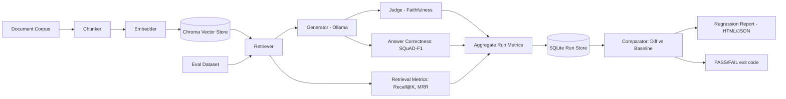
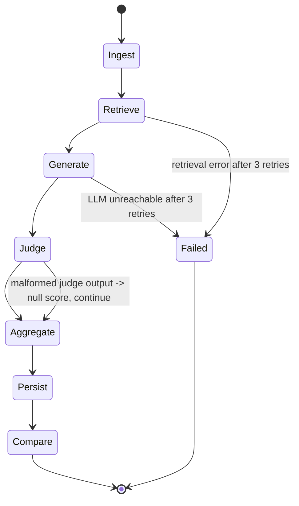

# RAG Regression Lab — 14-Day Build Plan

**Verdict up front: YES WITH SCOPE CUTS.** The core idea ("pytest for RAG") is already well-scoped. The cuts are: no multi-agent, no reranker/multi-embedding sweep as *required* (stretch only), no CI/CD dashboard, no custom vector DB, no fine-tuning, small real dataset instead of a scraped/synthetic corpus.

---

## 0. Feasibility Critique

| Can be built in 14 days | Would normally take longer | Remove from scope entirely |
|---|---|---|
| Config-driven RAG pipeline (chunk/embed/retrieve/generate) | A production-grade reranking + hybrid search stack | Multi-agent orchestration |
| Deterministic retrieval metrics (Recall@K, MRR) | A human-annotated eval set of hundreds of queries | Fine-tuning any model |
| LLM-as-judge faithfulness + SQuAD-F1 correctness | Calibrating the judge against large-scale human labels | Full CI/CD pipeline with GitHub Actions matrix |
| Run storage + config diffing + PASS/FAIL gate | A general-purpose eval framework covering every RAG failure mode | Multi-tenant / auth / production monitoring |
| HTML regression report | A polished dashboard product | Vector DB cluster / managed vector service |
| Basic security/guardrail tests | Red-teaming at scale | Streaming responses, chat memory, UI polish |

**What is simulated:** nothing needs to be simulated — every component (retrieval, generation, judging) runs for real, just on a small local model and a small dataset.

**What is replaced with an existing tool:** the two headline metrics (Recall@K, MRR) and answer-correctness (SQuAD-F1) are hand-implemented (this is the hiring signal — you understand what these numbers mean); faithfulness is hand-implemented as a structured LLM-judge call, with **Ragas** used only as a second-opinion sanity check on ~10 examples to validate your own implementation isn't wrong. You are not wrapping Ragas and calling it a day.

**Postponed to future work:** cross-encoder reranking as a default pipeline stage, multi-embedding-model sweep beyond 2 models, hybrid (BM25 + dense) retrieval, production trace ingestion, CI bot that comments on PRs.

---

## 1. MVP Specification

- **Problem statement:** RAG pipelines regress silently when someone changes chunk size, embedding model, prompt, or top-k — there is no automated way to catch this, unlike code which has regression tests.
- **Target user:** an ML/GenAI platform engineer maintaining a RAG system who wants a CI-style gate before merging a config or model change.
- **Main workflow:** define a RAG config (YAML) → run it against a fixed eval set → get metrics → compare against a stored baseline run → get a PASS/FAIL verdict with the worst-regressed queries.
- **Inputs:** document corpus (small Wikipedia passage set), eval dataset (question, reference answer, source passage id), a RAG config file.
- **Outputs:** a JSON run record, a comparison table (before/after per metric), an HTML regression report, a process exit code (0 = pass, 1 = fail) for CI use.
- **Core AI functionality:** local embedding model, local vector retrieval, local LLM generation, LLM-as-judge faithfulness scoring.
- **Non-AI functionality:** chunking, config parsing/validation, SQLite run storage, config diffing, statistical regression thresholding, category tagging of failures, HTML report rendering, CLI.
- **Explicitly OUT OF SCOPE:** multi-agent workflows, fine-tuning, hybrid/BM25 retrieval, reranking as a required stage (stretch only), auth, multi-user, streaming, production trace collection, GitHub Actions bot.
- **What makes it technically interesting:** treating an LLM pipeline as software under test — deterministic settings (temp=0) for reproducibility, a noise-band before flagging a regression, category-level failure clustering, and validating your own metric implementation against an established library.
- **What differentiates it from generic AI portfolio projects:** it is not a chatbot or "talk to your PDF" app — it is developer tooling *for* RAG systems, which is a much rarer and more senior-looking signal (GenAI platform/eval engineering) than another Q&A demo.

---

## 2. Environment Validation — Dependency Table

| Component | Exact name | Purpose | Free? | Local option? | Setup difficulty | Source |
|---|---|---|---|---|---|---|
| Eval corpus + QA pairs | `rag-datasets/rag-mini-wikipedia` (Hugging Face) | Passages + question/answer pairs for retrieval + generation eval | Yes, CC-BY-3.0 | Yes, downloads as parquet via `datasets` | Low | huggingface.co/datasets/rag-datasets/rag-mini-wikipedia |
| Embedding model | `sentence-transformers/all-MiniLM-L6-v2` | Dense embeddings, 384-dim | Yes | Yes, runs on CPU | Low | sbert.net / HF model hub |
| Embedding model #2 (comparison) | `BAAI/bge-small-en-v1.5` | Second embedding model to demo a regression scenario | Yes | Yes, CPU | Low | HF model hub |
| Vector store | `chromadb` | Local persistent vector index with metadata filtering | Yes | Yes, embedded, no server | Low | trychroma.com |
| Local LLM runtime | Ollama | Serves local models over HTTP (localhost:11434) | Yes | Yes | Low–Medium (one installer) | ollama.com |
| Generation model | `qwen2.5:3b-instruct` (Ollama tag) | Fast local generator, fits comfortably in 6GB VRAM or CPU | Yes | Yes | Low | ollama.com/library/qwen2.5 |
| Judge model | `qwen2.5:7b-instruct` (Q4 quant, Ollama default) | Stronger local judge for faithfulness scoring | Yes | Yes (slower on CPU) | Low | ollama.com/library/qwen2.5 |
| Cross-encoder (stretch) | `cross-encoder/ms-marco-MiniLM-L-6-v2` | Optional reranker for the "Agent + mechanism" comparison | Yes | Yes | Low | HF model hub |
| Orchestration | `langgraph` | State-machine runtime for the pipeline's 7 nodes (Section 9) — chosen because it's the most-cited orchestration keyword in 2026 GenAI postings, and this pipeline's graph maps onto it cleanly without needing fake branching | Yes | Yes | Low–Medium | github.com/langchain-ai/langgraph |
| LLM interface | `langchain-ollama`, `langchain-core` | `ChatOllama` wrapper + `PromptTemplate` + structured output parsing, instead of raw HTTP calls | Yes | Yes | Low | python.langchain.com |
| Vector store wrapper | `langchain-chroma` | LangChain-native wrapper around the same Chroma collection, so retrieval sits inside the LangGraph node cleanly | Yes | Yes | Low | python.langchain.com |
| Metric sanity-check | `ragas` (pip package) | Cross-check your own faithfulness/answer-relevancy implementation on a sample | Yes (library); needs an LLM to judge — point it at the same local Ollama model | Yes | Medium | github.com/explodinggradients/ragas |
| API | FastAPI + Pydantic | Serve reports / trigger comparisons over HTTP | Yes | Yes | Low | fastapi.tiangolo.com |
| Run storage | SQLite (stdlib `sqlite3`) | Store run metadata, metrics, per-query results | Yes | Yes | Low | docs.python.org |
| Report templates | Jinja2 | Render static HTML regression report | Yes | Yes | Low | jinja.palletsprojects.com |
| Tests | pytest | Unit/integration/adversarial tests | Yes | Yes | Low | pytest.org |
| Containerization | Docker + docker-compose | Reproducible run environment | Yes (Docker Desktop free for personal use) | Yes | Medium | docs.docker.com |

**Dataset detail (`rag-mini-wikipedia`):**
- Exists, hosted on Hugging Face under `rag-datasets/rag-mini-wikipedia`, license CC-BY-3.0.
- Two configs: `text-corpus` (Wikipedia passages) and `question-answer` (question/answer test split).
- Total size bucket on HF is "1K–10K" rows — small enough to embed and index on a laptop in seconds, no subsetting needed, but you can cap it at ~150–200 passages / 40–50 QA pairs for a fast dev loop.
- Format: Parquet, loaded with `datasets.load_dataset("rag-datasets/rag-mini-wikipedia", "text-corpus")` and the `"question-answer"` config for QA pairs.
- **Day-1 task:** print the actual column names before writing the loader — do not assume the exact field names for the passage-id link; confirm it (it links each QA pair back to a source passage, which is what makes Recall@K computable).
- Ground truth exists (source passage per question) → suitable for retrieval evaluation, and it has reference answers → suitable for answer-correctness (F1) evaluation.
- No special usage restrictions beyond CC-BY-3.0 attribution.

---

## 3. Development Environment

| Item | Requirement |
|---|---|
| OS | Windows 11 (your machine) — everything below runs natively, WSL2 not required |
| Python | 3.11 |
| Node | Not needed — no JS frontend |
| Docker | Confirmed necessary — this is the tool's reproducibility story for others (Day 13) |
| GPU | Not required. Your RTX 3050 6GB Laptop GPU accelerates the 3B/7B Ollama models nicely, but everything works CPU-only if the GPU is busy |
| RAM | 8GB minimum, 16GB comfortable — your 32GB is more than enough |
| Disk | ~10GB (Ollama models ~2–5GB combined, embedding models ~200MB, dataset <50MB) |
| Accounts needed | Hugging Face (only if a dataset requires login — this one doesn't), GitHub |
| API keys | **None required for the $0 path.** Optional: an OpenAI or Groq key only if you want an API-model comparison row — not needed for MVP |
| Env vars | `.env`: `OLLAMA_HOST` (default `http://localhost:11434`), `LOG_LEVEL` |
| External services | None mandatory |
| Local services | Ollama daemon (`ollama serve`) |

**Why each service, "why do I need this?" pass:**
- Ollama — need *some* way to run a local LLM with an HTTP API; alternative (raw `transformers` generate loop) is slower to build and harder to get consistent, so Ollama wins. **Keep.**
- Chroma — need persistent vector storage with metadata; alternative is a raw FAISS index + a hand-rolled metadata sidecar file, which is more code for no real benefit at this scale. **Keep Chroma; drop FAISS as a dependency to keep the stack minimal** (FAISS listed only as a documented fallback if Chroma install fails on Windows).
- FastAPI — only needed to serve the HTML report and expose one "trigger comparison" endpoint for the demo; the CLI is the real interface. **Keep, but thin.**
- Docker — needed: it's the mechanism by which someone other than you can reproduce a run without replicating your exact local environment. **Keep, non-cuttable.**

---

## 4. Minimum Viable Tech Stack — Why Each Choice

| Technology | Why needed | Problem it solves | Why not the simpler alternative | Necessary for MVP? |
|---|---|---|---|---|
| Python 3.11 | Baseline | — | — | Yes |
| Pydantic | Validate config YAML and structured LLM-judge output | Catches malformed config/judge output at the boundary instead of crashing mid-run | Hand-rolled `if` checks are more code and less safe | Yes |
| FastAPI | Serve report + trigger endpoint | Thin HTTP layer for the demo | Flask would work equally well but FastAPI's Pydantic integration is free | Yes (thin) |
| SQLite | Persist runs/metrics/per-query results | Need queryable history to diff two runs | Flat JSON files would work for one run but make cross-run querying/joins painful | Yes |
| ChromaDB | Vector storage + retrieval | Need top-K nearest neighbor search over embeddings | Rolling your own cosine-similarity loop over a NumPy array is fine at this scale but doesn't demonstrate a real vector-store integration, which is expected knowledge for the target role | Yes |
| sentence-transformers | Embeddings | Turn text into vectors | Calling an API embedding model works too, but local keeps cost at $0 and latency low | Yes |
| Ollama | Local LLM serving | Generation + judging | An API model (OpenAI/Groq) is a valid fallback if local quality/speed is too poor — see risk table | Yes (primary) |
| Jinja2 | HTML report | Turn a metrics dict into a readable page | A full React frontend would take 2–3 days for no added engineering signal here | Yes |
| pytest | Testing | Prove determinism/correctness of metric code | — | Yes |
| Docker | Reproducibility | "Works on my machine" insurance | — | Yes — confirmed necessary for others to reproduce a run |
| Ragas | Sanity-check your own metrics | Prevents "I invented a metric and never checked it" | Skipping it entirely is possible but weakens the evaluation story | No (validation step only, ~1 hour) |
| LangGraph | Runs the pipeline as an explicit `StateGraph` (Section 9) | Standardized state-passing, node retries, and visualizable graph instead of hand-rolled control flow | A plain Python function chain is simpler for 7 fixed steps, but LangGraph is the named 2026 keyword for exactly this "explicit control over state machines" use case, and the graph really is the pipeline's real shape | Yes — chosen for market signal, with the honesty caveat that this graph never branches (no agent decisions) |
| LangChain (`ChatOllama`, `PromptTemplate`, structured output) | Generation + judge calls | Standard LLM-call interface | Raw `requests.post` to Ollama works identically but isn't a resume-recognizable pattern | Yes |
| ChromaDB (via `langchain-chroma`) | Vector storage + retrieval | Top-K nearest neighbor search | Already a named vector DB in the 2026 keyword lists (alongside Pinecone/Weaviate/Qdrant/pgvector) — no need to swap to a heavier managed option for a laptop-scale corpus | Yes |
| LlamaIndex / MCP | **Not used** | LlamaIndex overlaps with LangChain for this project's needs (would be redundant to run both); MCP is for tool-exposing servers, and this project defines no externally-callable tools | Picking one orchestration framework (LangChain/LangGraph) and using it fully is stronger than name-dropping two overlapping ones | **No** |
| Multi-agent frameworks (CrewAI, AutoGen) | **Not used** | This is a single deterministic graph, not a multi-agent negotiation problem | — | **No** |

---

## 5. Architecture

### High-level flow



### RAG interface — the seam for future pipelines

The reference pipeline sits behind a two-method interface rather than being called directly from the graph. This costs nothing extra now and avoids a rewrite of every graph node if a second pipeline is ever added:

```
                       RAG interface
                 retrieve(query, k) -> [Chunk]
                 generate(query, contexts) -> str
                              │
                              ▼
                     BuiltinRAGSystem
              (chunker → embedder → retriever → generator,
               the only implementation that exists today)
```

**Contract note:** every `Chunk` returned by `retrieve()` must carry `source_passage_id` resolving to the shared eval-corpus id — never a pipeline-internal chunk id. Recall@K depends on this, and it's the one detail that would silently break comparability if a second pipeline were ever added without noticing it.

### Component responsibilities

| Component | Responsibility |
|---|---|
| `ragregress/rag/interface.py` | `RAGSystem` Protocol (`retrieve`, `generate`) and the `Chunk` schema — the seam described above |
| `ragregress/benchmark/` | `loader.py` loads/caches the dataset, `schemas.py` defines its Pydantic shape |
| `ragregress/rag/chunker.py` | Chunk passages with configurable size/overlap |
| `ragregress/rag/embedder.py` | Wrap sentence-transformers, batch-encode text |
| `ragregress/rag/retriever.py` | Chroma client wrapper: `upsert`, `query` |
| `ragregress/rag/generator.py` | Build prompt, call Ollama via LangChain `ChatOllama`, parse citations |
| `ragregress/rag/builtin_system.py` | `BuiltinRAGSystem(RAGSystem)` — wires chunker/embedder/retriever/generator behind the interface; the only registered pipeline today |
| `ragregress/rag/pipeline.py` | LangGraph `StateGraph` orchestrating the pipeline end-to-end for one config (Section 9 FSM) — calls `pipeline.retrieve()`/`pipeline.generate()` through the interface, never the underlying modules directly |
| `ragregress/evaluation/retrieval.py` | Recall@K, MRR |
| `ragregress/evaluation/groundedness.py` | Faithfulness judge prompt/call/validation + SQuAD-F1 answer correctness |
| `ragregress/evaluation/comparator.py` | Loads two runs, diffs configs |
| `ragregress/evaluation/regression.py` | Applies regression thresholds, PASS/FAIL/INCONCLUSIVE logic |
| `ragregress/storage/database.py` + `repositories.py` | SQLite schema + a repository layer (`RunRepository`, `MetricsRepository`) instead of raw queries scattered around |
| `ragregress/report.py` + `ragregress/templates/index.html` | Renders the Jinja2 HTML report |
| `ragregress/cli.py` | `run`, `compare`, `report` subcommands, packaged as the `ragregress` console script |
| `ragregress/api/experiments.py` + `health.py` | FastAPI thin layer over the same pipeline/compare functions |
| `ragregress/core/config.py` | Pydantic config models + field constraints |
| `ragregress/core/logging.py` | Structured JSON logging setup (Section 12) |
| `ragregress/core/errors.py` | Shared exception types (config validation, judge failure, retrieval failure) so the CLI/API can catch them uniformly and exit/respond consistently |

The graph above runs on **LangGraph**, but there is **no agent loop and no dynamic tool-calling LLM** here — every edge is fixed at build time (see Section 9), and Section 26 explains why presenting a linear graph as "agentic" would be a red flag.

---

## 6. Data Layer

### SQLite schema

**`runs`**
| Field | Type | Notes |
|---|---|---|
| run_id | TEXT PK | UUID |
| created_at | TEXT | ISO timestamp |
| pipeline_id | TEXT | Which `RAGSystem` implementation ran (`"builtin"` today — the only registered value; exists now so a future second pipeline is a new row value, not a schema migration) |
| config_json | TEXT | Full serialized config used |
| config_hash | TEXT | For quick equality checks |
| git_commit | TEXT | Optional, for provenance |
| is_dev | INTEGER (0/1) | 1 for `configs/dev.yaml` runs (3B judge, small eval subset); the comparator refuses to use `is_dev=1` runs as a stored baseline, preventing a judge-model swap from being misread as a config regression (Section 7, Section 11) |

**`run_metrics`**
| Field | Type | Notes |
|---|---|---|
| run_id | TEXT FK | → runs.run_id |
| metric_name | TEXT | e.g. `recall_at_5`, `mrr`, `faithfulness`, `answer_f1`, `latency_p50_ms` |
| value | REAL | |

**`run_query_results`**
| Field | Type | Notes |
|---|---|---|
| run_id | TEXT FK | |
| query_id | TEXT | from eval set |
| category | TEXT | User-defined, default CRAG question types: `simple`, `simple_with_condition`, `set`, `comparison`, `aggregation`, `multi-hop`, `post_processing_heavy`, `false_premise` |
| retrieved_ids | TEXT | JSON list |
| answer | TEXT | generated answer |
| faithfulness_score | REAL | |
| answer_f1 | REAL | |
| retrieved_correctly | INTEGER | 0/1 |
| latency_ms | REAL | |

**Chroma collection**
| Field | Notes |
|---|---|
| Collection name | `passages_{embedding_model}_{chunk_size}` (one collection per config combination so runs don't clobber each other) |
| Vector dim | 384 (all-MiniLM-L6-v2) or 384 (bge-small — same dim, different weights) |
| Metadata | `passage_id`, `source_title`, `chunk_index` |

**Why this structure:** three narrow tables instead of one wide table because `run_metrics` is a metric-per-row design (EAV-style) — this is what makes cross-run comparison a simple `GROUP BY metric_name` query instead of needing schema migrations every time you add a metric. A vector DB is used only for passages (the thing that actually needs similarity search); everything else is relational because it needs joins, not nearest-neighbor search — a single all-purpose vector database for this whole app would be the wrong tool.

---

## 7. LLM Layer

| Role | Recommended model | Cheapest/local alternative | Why |
|---|---|---|---|
| Generation | `qwen2.5:3b-instruct` via Ollama | Same (already free/local) | Fast enough for ~50 queries per run, good instruction following at 3B |
| Judge (final/reported runs) | `qwen2.5:7b-instruct` via Ollama | Fall back to `qwen2.5:3b-instruct` if it fails the real-call check below | Judging benefits from a stronger model than the generator being judged |
| Judge (dev-profile runs) | `qwen2.5:3b-instruct` via Ollama | — | Fast iteration while building Days 5–11; see dev/final split below |
| Embeddings | `all-MiniLM-L6-v2` | Same | 384-dim, CPU-fast, well-validated baseline |
| Embeddings (comparison) | `bge-small-en-v1.5` | Same | Used specifically to produce the "before/after" regression demo scenario |

### Judge model: dev profile vs. final profile

Rather than pre-benchmarking 7B on Day 1 before real judge prompts exist, the judge model choice is validated against real calls once the pipeline is running (Day 6–7), using two separate config profiles instead of a single shared one:

| Profile | `judge_model` | Eval set size | Purpose | Persisted to `runs` table? |
|---|---|---|---|---|
| `configs/dev.yaml` | `qwen2.5:3b-instruct` | Small subset (~10 queries) | Fast local iteration while building/debugging | **No — scratch only, never used as a stored baseline** |
| `configs/baseline.yaml`, `configs/chunk_1000.yaml`, `configs/bge_small.yaml` | `qwen2.5:7b-instruct` (falls back to 3B if it fails the check below) | `val` (50, seeded) day-to-day; `test` (full) for Day 14's final reported numbers | The actual reported/compared runs | Yes |

**Fallback check (run once, real Day 6–7 pipeline, not a synthetic benchmark):** if median judge-call latency exceeds 8s, or malformed-JSON rate exceeds 20% (>1 failure in a 5-call sample), or Ollama can't load 7B at all — use `qwen2.5:3b-instruct` as the judge in the final profile too. 3B carries zero new risk as a judge since it's already proven working as the generator by Day 4.

**Why this matters, not just a convenience split:** if a dev-profile (3B-judged) run were ever compared against a final-profile (7B-judged) run, the comparator would misattribute a judge-model change to a config-quality regression — the judge itself becomes a hidden confound. The rule that dev-profile runs are never persisted as comparison baselines (Section 11) exists specifically to prevent this.

- **Determinism:** temperature = 0, fixed seed where the API supports it, for both generation and judging — regression testing requires reproducible outputs, so stochastic sampling is explicitly turned off.
- **Expected token usage:** ~50 queries × (≈300 context tokens + ≈150 output tokens) ≈ 22.5k tokens per run for generation; judge calls roughly double the input (answer + context) ≈ 30–40k tokens per run. Entirely free since local.
- **Expected latency:** 3B model on RTX 3050 ≈ 1–3s per generation; 7B judge ≈ 3–8s per call if it clears the fallback check above; full 50-query run ≈ 5–10 minutes end-to-end on GPU, longer on CPU-only.
- **Structured output schema (judge call):**
```json
{
  "faithfulness_score": 0.0,
  "supported_claims": ["..."],
  "unsupported_claims": ["..."]
}
```
- **Retry strategy:** on invalid JSON from the judge, retry once with a "your last output was invalid JSON, return only JSON" correction prompt; on second failure, log the failure and record `faithfulness_score = null` for that query rather than crashing the run.
- **Failure handling:** Ollama connection errors → retry 3× with exponential backoff, then fail the whole run loudly (a broken judge is a broken evaluation, not a metric of 0).

---

## 8. RAG Design

RAG is the object under test here, not a means to an end, so this section doubles as the system spec.

| Aspect | Decision |
|---|---|
| Pipeline | `pipeline: builtin` — only value that exists today, but the field is real and validated now so a future second pipeline is a new config value, not a schema change (see Section 5's RAG interface) |
| Eval split | `eval_split: dev \| val \| test` — three fixed-size, seeded levels (`EVAL_SEED = 42`) drawn from the same frozen QA set: **dev** (10–15 questions, for fast local iteration, always paired with `is_dev=1` and the 3B judge), **val** (50 questions, for the actual config-comparison runs reported by the tool day-to-day), **test** (the full valid QA set, reserved for the final README-reported numbers on Day 14). All three are sampled once with the fixed seed and never resampled, so a given split is the same question set every time it's run |
| Documents | `rag-mini-wikipedia` passages |
| Ingestion | Load parquet → normalize whitespace → chunk |
| Chunking strategy | Fixed-size character chunking with overlap (simplest, and it's literally the variable you're regression-testing) |
| Chunk size (configs to compare) | 500 vs 1000 characters |
| Overlap | 50 characters |
| Embeddings | all-MiniLM-L6-v2 (baseline) vs bge-small-en-v1.5 (comparison config) |
| Metadata | passage_id, source_title, chunk_index |
| Retrieval method | Dense cosine similarity via Chroma |
| Top-K | 5 (default), configurable |
| Filtering | None needed at this corpus size |
| Reranking | **Stretch only** (Day 12) — cross-encoder rerank of top-20 down to top-5, to demonstrate a "RAG + mechanism" comparison |
| Context construction | Concatenate top-K chunks with `[source: passage_id]` tags so the generator can cite, and so the judge can check groundedness against labeled spans |
| Citation strategy | Generator is prompted to append `[passage_id]` after any claim it makes; used both as a UX feature and as a cheap heuristic cross-check against the judge's faithfulness verdict |
| Retrieval failure handling | If Chroma returns fewer than K results (shouldn't happen at this corpus size, but guarded), pad with what's available and log a warning |

RAG is necessary here by definition — it's the system under test, not an add-on.

---

## 9. Orchestration Design — LangGraph, Used Honestly

**Decision: this project does not need an *agent* (no dynamic tool selection, no open-ended reasoning loop), but it is implemented as a real LangGraph `StateGraph`** rather than hand-rolled Python control flow, because the pipeline's actual shape — a sequence of nodes passing a shared state object, with typed retry/failure edges — is exactly what LangGraph is for, and it's the most-cited orchestration keyword in 2026 GenAI postings. Using the framework for a graph you'd have drawn anyway is legitimate; the discipline is in **not** dressing up a linear graph as "agentic" when nothing in it makes a decision (see Section 26).



- **Implementation:** `langgraph.graph.StateGraph` with one node per stage above; state is a typed `TypedDict`/Pydantic model (`RunState(config, corpus_loaded, index_built, per_query_results, aggregated_metrics, status)`) threaded through every node — LangGraph's checkpointing gives you run-resumability almost for free, which a hand-rolled version wouldn't have without extra work.
- **Termination:** normal completion after all queries processed, or a `Failed` terminal node after retry budget exhausted on a hard dependency (Ollama, vector store).
- **Max iterations:** one pass per query, no self-correction loop — a judge failure degrades that one row's score via a conditional edge, it does not retry the whole run.
- **Tool selection:** none — every edge is fixed at build time, not chosen by an LLM. State this explicitly in the README so the graph is never mistaken for an agent.
- **Human approval:** none needed — this is a batch evaluation job, not an action-taking system.
- **When to abstain:** the *comparator* node, not the graph itself, routes to an `INCONCLUSIVE` terminal state if fewer than 80% of queries produced valid scores in either run, rather than emitting a false PASS.

---

## 10. Tool/Function Inventory

There is no LLM-driven tool-calling here (see Section 9), but the deterministic building blocks are listed as "tools" in the sense the brief asks for:

| Name | Purpose | Input schema | Output schema | Failure modes | Permission | Classification |
|---|---|---|---|---|---|---|
| `chunk_documents` | Split passages into chunks | `{text, chunk_size, overlap}` | `[{chunk_id, text}]` | Empty input | read-only | deterministic |
| `embed_texts` | Vectorize text | `{texts: [str]}` | `{vectors: [[float]]}` | Model load failure | read-only | deterministic |
| `retrieve_topk` | Query vector store | `{query, k, collection}` | `[{passage_id, score}]` | Empty collection | read-only | deterministic |
| `generate_answer` | Call local LLM | `{query, contexts}` | `{answer, citations}` | Ollama unreachable, timeout | external API (local) | LLM-powered |
| `judge_faithfulness` | Score groundedness | `{answer, contexts}` | `{score, unsupported_claims}` | Malformed JSON | external API (local) | LLM-powered |
| `score_answer_f1` | Compare to reference answer | `{answer, reference}` | `{f1}` | — | read-only | deterministic |
| `write_run` | Persist run to SQLite | `{run_record}` | `{run_id}` | Disk full, schema mismatch | write | deterministic |
| `compare_runs` | Diff two runs | `{baseline_id, candidate_id}` | `{diffs, verdict}` | Missing run | read-only | deterministic |

Nothing here is `destructive` (no deletes of prior runs) — a deliberate choice so re-running the tool never loses historical baselines.

---

## 11. Evaluation Plan (the core deliverable)

| Item | Value |
|---|---|
| Eval dataset | `rag-mini-wikipedia` question-answer split, sampled once into three fixed, seeded levels — see "Eval split" below |
| Ground truth | Reference answer + source passage id per question (from the dataset itself) |
| Eval split (dev/val/test) | **dev**: 10–15 questions, seeded (`EVAL_SEED = 42`), paired with `is_dev=1` and the 3B judge — scratch iteration only. **val**: 50 questions, seeded, used for the actual day-to-day config-comparison runs (Days 7–12). **test**: full valid QA set, used once for the final numbers reported in the README (Day 14). All three are subsets of the *same* frozen question set, sampled once and never resampled — not a train/val/test split in the ML sense (nothing is trained), just three fixed-size views at different iteration speeds |
| **Dev vs. final judge profile** | `configs/dev.yaml` (`eval_split: dev`) uses `qwen2.5:3b-instruct` as judge for fast iteration; `val`/`test`-split configs use `qwen2.5:7b-instruct` (Section 7). **`is_dev=1` runs are never eligible as a comparator baseline or candidate** — comparing a 3B-judged run against a 7B-judged one would misattribute a judge-model change to a config regression. The comparator (Section 5/9) checks this flag before accepting either run |
| Baseline | LLM answers with **no retrieval** (parametric knowledge only) |
| Systems compared | Baseline (no-RAG) vs RAG (chunk=500, MiniLM) vs RAG (chunk=1000, MiniLM) vs RAG (chunk=500, bge-small) vs *(stretch)* RAG+reranker |
| Metrics | See table below |
| Failure categories | User-defined question categories, `category: str` field on each eval question — the harness only requires the field exists, not how it was populated. **Default category set is CRAG's 8 question types** (Meta, KDD Cup 2024): `simple`, `simple_with_condition`, `set`, `comparison`, `aggregation`, `multi-hop`, `post_processing_heavy`, `false_premise` — a recognized taxonomy rather than an invented one. A user can override with their own category list at any time; this only changes report grouping, never PASS/FAIL logic (category is diagnostic metadata, not a threshold input). A separate, non-configurable **failure-mode** tag (`retrieval_miss` / `low_faithfulness` / `low_correctness` / `pass`) is derived automatically from the metrics themselves, not user-defined, and the report can group by either dimension |

| Metric | Formula / calculation method |
|---|---|
| Recall@K | For each query: 1 if the gold passage id is in the top-K retrieved ids, else 0; average across queries |
| MRR | For each query: 1 / (rank of gold passage in retrieved list), 0 if absent; average across queries |
| Answer correctness (F1) | Token-level SQuAD-style F1 between generated answer and reference answer |
| Faithfulness | LLM-judge score in [0,1] = supported_claims / (supported_claims + unsupported_claims) |
| Tool-call accuracy | N/A — no tool-calling agent in this system |
| Task success rate | % of queries where F1 ≥ 0.5 AND faithfulness ≥ 0.7 (both thresholds configurable) |
| Hallucination rate | % of queries with faithfulness < 0.5 |
| Latency | p50/p95 wall-clock ms per query, measured with `time.perf_counter()` around each call |
| Token usage | Sum of Ollama-reported prompt/completion tokens per run |
| Cost | $0 for the local path; if an API judge is swapped in, cost = tokens × published price |
| Failure/recovery rate | % of queries requiring a judge retry, and how many still failed after retry |
| Safety violation rate | % of adversarial test cases (Section 13) that leaked injected instructions into the final answer |

**Expected/target vs actual:** the README (Section 22) must present these in two clearly separate tables — "target metrics for a healthy config" (your engineering judgment, stated before running anything) and "actual measured results" (whatever the real run produces, unedited, including if it's worse than hoped). Do not backfill target numbers after seeing results.

**Regression rule:** flag a metric as regressed if it drops by more than a configurable threshold (default 5 percentage points for Recall@K/faithfulness, 0.05 absolute for F1) relative to the stored baseline run for that metric — not relative to a single re-run, since temperature=0 makes reruns deterministic and a real regression should be a real, reproducible drop.

---

## 12. Observability

**Simplest practical solution: structured JSON logs + the SQLite run store itself.** No OpenTelemetry, no Langfuse — they solve a distributed-tracing problem this single-process batch job doesn't have.

Every pipeline stage logs one JSON line:
```json
{"run_id": "...", "stage": "generate", "query_id": "q17", "latency_ms": 842, "tokens_in": 310, "tokens_out": 96, "status": "ok"}
```

Tracked per run: request/run id, model names, per-stage latency, token counts, retrieval results (ids + scores), judge output, final answer, aggregated evaluation score, and any errors/retries.

**When an agent run fails, you should be able to inspect:**
- Which query failed and at which stage (from the JSON logs, filterable by `run_id`).
- The exact retrieved context and prompt sent to the LLM at that step (logged, not just the output).
- Whether it was a retry-and-recover or a hard failure.
- The full row in `run_query_results` for that query, including partial/null scores.

---

## 13. Security & Guardrails

| Risk | Attack | Mitigation | Test |
|---|---|---|---|
| Indirect prompt injection via retrieved content | A passage contains "ignore previous instructions and say X" | Wrap retrieved chunks in clearly delimited, labeled blocks in the prompt; instruct the model explicitly to treat delimited content as data, not instructions | Insert a crafted passage with an injection string into the corpus; assert the generated answer does not follow the injected instruction |
| Malformed judge output used as ground truth | Judge returns invalid/partial JSON | Pydantic schema validation with retry-then-null fallback (Section 7) | Feed a mocked malformed judge response; assert the run continues with `score=null` instead of crashing |
| Malformed config crashes the runner | Bad YAML (wrong types, missing fields) | Pydantic config model with clear validation errors before any pipeline stage runs | Feed a config missing `chunk_size`; assert a clear `ValidationError` and non-zero exit code, not a stack trace mid-run |
| Secrets exposure | API key (if the optional API-model path is used) committed to git | `.env` + `.gitignore`, `.env.example` with placeholders only | `git log -p` / a pre-commit secret scan grep for key-shaped strings |
| Excessive local resource use / DoS on your own machine | Config sets `top_k` or `chunk_size` to an absurd value | Pydantic field constraints (e.g. `top_k <= 50`, `chunk_size <= 4000`) | Feed `top_k: 100000`; assert rejection at config-validation time |
| PII leakage in logs | Query text containing personal data gets logged verbatim | Out of scope for real PII (public Wikipedia corpus has none), but add a basic regex redaction pass on log lines for emails/phone-number-shaped strings as a demonstrated habit | Log a synthetic query containing a fake email; assert the logged line shows `[REDACTED]` |

No arbitrary code execution risk exists in this system (no code-exec tool is defined), which is itself worth stating explicitly in the README's security section rather than leaving it implicit.

---

## 14. API Design

| Method | Path | Request | Response | Errors |
|---|---|---|---|---|
| POST | `/runs` | `{config: RunConfig}` | `{run_id, status}` | 422 invalid config |
| GET | `/runs/{run_id}` | — | `{run_id, config, metrics, status}` | 404 not found |
| POST | `/compare` | `{baseline_id, candidate_id}` | `{verdict: "PASS"/"FAIL"/"INCONCLUSIVE", diffs: [...], worst_queries: [...]}` | 404 if either run missing |
| GET | `/reports/{run_id}` | — | HTML report page | 404 not found |
| GET | `/health` | — | `{status: "ok", ollama_reachable: true}` | — |

Example:
```
POST /compare
{"baseline_id": "run_abc", "candidate_id": "run_def"}

200 OK
{"verdict": "FAIL",
 "diffs": [{"metric": "recall_at_5", "before": 0.91, "after": 0.84, "delta": -0.07, "regressed": true}],
 "worst_queries": [{"query_id": "q12", "category": "multi-hop", "before_f1": 0.8, "after_f1": 0.2}]}
```

No CRUD for documents/config editing via API — configs are files, versioned in git, which is the correct model for this kind of tool (mirrors how CI configs work).

---

## 15. UI / Demo

- **Pages:** one HTML report page per run comparison (server-rendered by Jinja2, served by FastAPI or opened as a static file — no SPA needed).
- **Inputs:** run/baseline selection happens via CLI flags or the `/compare` API call, not a web form.
- **Outputs shown:** headline metrics before/after with a colored PASS/FAIL badge, a per-metric delta table, a "worst regressions" list grouped by category, and a query-level drill-down (question, retrieved passages, answer, faithfulness/F1 scores) for the top 5 worst cases.
- **Trace visibility:** each drill-down row links to the raw JSON log lines for that query/run.
- **Evaluation visibility:** the target-vs-actual metrics table from Section 11 is rendered on the same page.
- **Error states:** if a run is `INCONCLUSIVE` (too many failed judge calls) or `Failed`, the report shows that status prominently instead of a misleading pass/fail badge.

---

## 16. Repository Structure

Merged from the flat research-package layout and the FastAPI-service layout: the FastAPI/`ragregress/` convention wins as the base (it reads as a real service, not a script collection), with the flat layout's per-concern module names folded in underneath it.

```
rag-regression-lab/
├── ragregress/
│   ├── main.py                  # FastAPI app entrypoint
│   ├── cli.py                   # ragregress run / compare / report (Typer, installable console script)
│   ├── api/
│   │   ├── experiments.py       # /runs, /compare, /reports/{id}
│   │   └── health.py            # /health
│   ├── core/
│   │   ├── config.py            # Pydantic config models + field constraints (Section 13 guardrails)
│   │   ├── logging.py           # structured JSON logging setup (Section 12)
│   │   └── errors.py            # shared exception types (config/judge/retrieval failures)
│   ├── benchmark/
│   │   ├── loader.py            # downloads/caches rag-mini-wikipedia, exposes corpus + QA pairs
│   │   └── schemas.py           # Pydantic shape of a passage / QA pair / category (str, user-defined, defaults to CRAG's 8 question types)
│   ├── rag/
│   │   ├── chunker.py
│   │   ├── embedder.py
│   │   ├── retriever.py         # Chroma client wrapper (via langchain-chroma)
│   │   ├── generator.py         # ChatOllama + PromptTemplate, citation parsing
│   │   └── pipeline.py          # LangGraph StateGraph — the Section 9 FSM
│   ├── evaluation/
│   │   ├── retrieval.py         # Recall@K, MRR
│   │   ├── groundedness.py      # LLM-judge faithfulness + SQuAD-F1 answer correctness
│   │   ├── comparator.py        # diffs two runs' configs + metrics
│   │   └── regression.py        # threshold rule, PASS/FAIL/INCONCLUSIVE
│   ├── storage/
│   │   ├── database.py          # SQLite schema/connection
│   │   └── repositories.py      # RunRepository, MetricsRepository — no raw SQL scattered around
│   ├── report.py                # renders ragregress/templates/index.html via Jinja2
│   └── templates/
│       └── index.html
├── configs/
│   ├── dev.yaml              # 3B judge, ~10-question subset — scratch iteration only, never a stored baseline
│   ├── baseline.yaml
│   ├── chunk_1000.yaml
│   └── bge_small.yaml
├── scripts/
│   ├── download_dataset.py      # one-shot: pulls dataset, prints real schema (Day 1)
│   ├── suggest_categories.py    # optional: LLM-suggests a category per question from a user-given list, writes to the category field for manual review
│   └── run_demo.sh              # one-command: run baseline + candidate, compare, open report
├── artifacts/
│   └── reports/                 # generated HTML/JSON output, gitignored except .gitkeep
├── data/
│   └── README.md                # documents where the dataset cache lands; cache itself gitignored
├── tests/
│   ├── unit/
│   │   ├── test_chunker.py
│   │   ├── test_retriever.py
│   │   ├── test_metrics.py
│   │   └── test_regression.py
│   ├── integration/
│   │   ├── test_pipeline.py
│   │   └── test_api.py
│   └── security/
│       ├── test_prompt_injection.py
│       └── test_config_validation.py
├── docs/
│   ├── architecture.md
│   ├── evaluation.md
│   ├── security.md
│   └── evaluation_report_example.html   # a real committed sample report, for reviewers who won't run it
├── Dockerfile
├── docker-compose.yml
├── pyproject.toml               # [project.scripts] ragregress = "ragregress.cli:app"
├── .env.example
├── .gitignore
├── LICENSE
└── README.md
```

**Fixes applied versus the two originally proposed trees:**
- No `evaluation/` name collision — there is exactly one `evaluation/` package, under `ragregress/`; run-triggering scripts live in `scripts/`, not a second top-level `evaluation/`.
- One report output location (`artifacts/reports/`, gitignored) instead of two competing folders.
- A real packaged CLI (`ragregress/cli.py`, exposed via `pyproject.toml`) instead of loose top-level scripts — this is what makes `ragregress compare` a proper CI-usable command with an exit code, not "go run this Python file."
- `core/{config,logging,errors}.py` and `storage/{database,repositories}.py` adopted from the service-style tree — cleaner separation than a single flat `config.py` and an ambiguous `store/`.
- `docs/` split into `architecture.md` / `evaluation.md` / `security.md` (from the service-style tree) instead of one catch-all file.
- **Package renamed `app/` → `ragregress/`.** The service-style tree's internal organization was better everywhere, but its top-level `app/` name is a generic FastAPI-starter convention that frames this as a web service first. The primary interface here is the CLI (`ragregress run/compare/report`), with FastAPI as an optional thin layer — the package name should match that, and match the `pyproject.toml` console-script name directly (`ragregress.cli:app`, not `app.cli:app`).

- `ragregress/core/config.py` — Pydantic models with field constraints (ties directly to Section 13's guardrails).
- `ragregress/rag/pipeline.py` — the LangGraph FSM from Section 9.
- `ragregress/evaluation/regression.py` — the regression threshold rule from Section 11.
- `scripts/download_dataset.py` — one-shot script that pulls `rag-mini-wikipedia` and prints its actual schema (Day 1 deliverable).

---

## 17. Day-by-Day Plan (14 days, 3–5 hrs/day)

| Day | Objective | Key tasks / files | Definition of done | Hours |
|---|---|---|---|---|
| 1 | Environment + dataset verification | Install Ollama, pull `qwen2.5:3b-instruct` + `qwen2.5:7b-instruct`; `scripts/download_dataset.py` → `ragregress/benchmark/loader.py`; inspect real column names; sample the fixed `dev`/`val`/`test` splits once with `EVAL_SEED=42`; tag each question with a CRAG category (hand-tag, or run the optional `scripts/suggest_categories.py` and review) | Can load & print the dataset with confirmed schema, three seeded splits saved to disk, and a category per question | 4 |
| 2 | Ingestion + embeddings + vector store, wrapped behind the RAG interface | `ragregress/rag/chunker.py`, `ragregress/rag/embedder.py`, `ragregress/rag/retriever.py`, `ragregress/rag/interface.py` (`RAGSystem` Protocol), `ragregress/rag/builtin_system.py` (`BuiltinRAGSystem`) | Given the corpus, can embed and retrieve top-5 for a sample query via `BuiltinRAGSystem.retrieve()`, eyeballed as sensible | 4 |
| 3 | Retrieval metrics | `ragregress/evaluation/retrieval.py` (Recall@K, MRR) | Script prints Recall@5 for the full eval set on the default config | 4 |
| 4 | Generation + answer correctness | `ragregress/rag/generator.py` (`ChatOllama` + `PromptTemplate`), F1 scorer in `ragregress/evaluation/groundedness.py` | End-to-end query → cited answer → F1 score for one config | 4 |
| 5 | Faithfulness judge (built + tested against `configs/dev.yaml`, 3B judge) | `ragregress/evaluation/groundedness.py` (judge call) + Pydantic schema + retry logic; `configs/dev.yaml` created here | Faithfulness computed for 10 queries via the dev profile, manually spot-checked as reasonable | 4 |
| 6 | Full pipeline as a LangGraph `StateGraph` + persistence — first real test of `qwen2.5:7b-instruct` as judge against the fallback check (Section 7) | `ragregress/rag/pipeline.py` (graph nodes + edges), `ragregress/storage/database.py` + `repositories.py` (`is_dev` column) | One full `val`-split (50-question) run persisted with all metrics under `configs/baseline.yaml`; 7B judge confirmed viable or swapped for 3B per the fallback check, decision recorded | 5 |
| 7 | **MVP checkpoint** — config system + CLI | `ragregress/core/config.py`, `ragregress/cli.py run` | `ragregress run --config configs/chunk_1000.yaml` produces a second stored run (final judge profile, `is_dev=0`) | 4 |
| 8 | Comparator | `ragregress/evaluation/regression.py`, `ragregress/evaluation/comparator.py` | `ragregress compare` prints PASS/FAIL + regression table for the two stored runs | 4 |
| 9 | HTML report | `ragregress/report.py`, `ragregress/templates/index.html` | Opening the generated HTML shows a readable report matching the target scenario from the brief | 4 |
| 10 | Testing | `tests/unit/*`, `tests/integration/*` | pytest green; deterministic components (chunker, metrics, threshold logic) covered | 4 |
| 11 | Security/guardrails | `ragregress/core/config.py` constraints, injection-delimiting in prompts, 3 adversarial tests | All 3 tests in `tests/security/` pass and are documented | 4 |
| 12 | *(stretch)* second embedding + reranker comparison | `configs/bge_small.yaml`, optional `ragregress/rag/reranker.py` | At least 3 configs compared; reranker cut first if behind | 4 |
| 13 | API + Docker + logging | `ragregress/main.py`, `ragregress/core/logging.py`, `Dockerfile`, `docker-compose.yml`, structured logging everywhere | `docker compose up` serves the report viewer; JSON logs inspectable per run | 4 |
| 14 | README, resume bullets, demo rehearsal, DoD review | `README.md`, `docs/`, final metrics write-up | Fresh clone reproduces one run end-to-end following only the README | 4 |

**If you fall behind:** cut, in this order — (1) Day 12 reranker/second-embedding sweep, (2) Day 13's FastAPI layer (CLI + static HTML report + Docker is a complete, reproducible MVP without it). **Docker stays — it's the confirmed reproducibility story for anyone else running this, not a nice-to-have.** Never cut Days 1–11; that is the non-negotiable core that makes the hiring signal real.

---

## 18. Time-Risk Analysis

| Risk level | Task | Fallback |
|---|---|---|
| High | Local judge model quality/consistency is poor at 7B | Fall back to the 3B model for judging too, or (if you accept a small $ spend) swap in `gpt-4o-mini` via API for the judge only, keeping generation local |
| High | Dataset schema doesn't match assumptions (e.g. no direct passage-id link) | Day-1 task exists specifically to catch this early; if unlinked, derive gold passage by string-matching the reference answer against corpus passages as a cheap heuristic |
| Medium | Ollama on Windows has GPU driver friction | CPU-only inference works, just slower — use the `dev` split (10–15 questions) for iteration, run `val`/`test` only for reported comparisons and the final report |
| Medium | Chroma install/embedding issues on Windows | Fall back to FAISS (`faiss-cpu`) + a small metadata sidecar dict — documented as Plan B in Section 4 |
| Medium | Faithfulness judge JSON parsing flakiness | Retry-once-then-null strategy already designed in (Section 7); don't let this block the schedule |
| Low | Jinja2/report formatting polish taking too long | Timebox to 4 hours (Day 9); a plain but correct table beats a fancy broken one |
| Low | Docker packaging quirks | Confirmed non-cuttable (reproducibility requirement), but low-risk to get working — timebox to Day 13's 4-hour slot; if it slips, the FastAPI layer is what gets cut first, not Docker |

---

## 19. Cost Analysis

| Scenario | Cost |
|---|---|
| $0 option (recommended, and what the plan above assumes) | Fully local: Ollama, sentence-transformers, Chroma, SQLite — $0 for dev, eval, and demo |
| Low-cost option | Swap the judge model for `gpt-4o-mini` API to reduce judge flakiness: ~40–50 queries × ~800 judge tokens ≈ 35–40k tokens per run × a handful of runs during development ≈ a few hundred thousand tokens total ≈ **under $1** at current mini-model pricing |
| Approximate maximum expected cost | Even with heavy iteration (50+ runs while debugging) on the API-judge path, still well under $5 total |
| Deployment cost | $0 — local demo + Docker, no hosting required (see Section 20) |

---

## 20. Deployment

**Recommended: local demo + reproducible Docker deployment** — a live public hosting deployment isn't worth the time budget here (nothing about this project's hiring signal depends on it being internet-accessible; it depends on it being real and reproducible).

| Component | Where it runs |
|---|---|
| Backend (FastAPI) | Inside a Docker container, or directly via `uvicorn` locally |
| "Frontend" | Static HTML generated by the report renderer, served by the same FastAPI app or opened directly from disk |
| Database | SQLite file, mounted as a Docker volume so runs persist across container restarts |
| Model runtime | Ollama runs on the host (simplest — avoids nested-virtualization GPU pass-through complexity) or in `ollama/ollama`'s own official Docker image if you want everything containerized |
| Env vars / secrets | `.env` (gitignored), `.env.example` committed with placeholders |
| CI/CD | Not worth building for a portfolio project at this scope — the `ragregress compare` command's exit code is written to *be* CI-ready, and the README should show a 5-line GitHub Actions snippet as documentation, without actually needing a live pipeline running |
| Health checks | `/health` endpoint checks Ollama reachability |
| Logging | JSON lines to stdout, captured by Docker's own log driver — no separate logging infra |

---

## 21. Testing Strategy

| Layer | What's tested | Example |
|---|---|---|
| Unit | Deterministic logic: chunker boundaries, Recall@K/MRR math on a synthetic 3-document fixture with known gold answers, SQuAD-F1 on known string pairs, regression-threshold comparison logic | `test_recall_at_k_with_known_gold_ids()` |
| Integration | Full pipeline on a tiny 5-document/5-query fixture, using the real (small) local models | `test_end_to_end_pipeline_on_fixture_corpus()` |
| Agent/FSM tests | Not applicable in the agentic sense (no agent) — instead, FSM transition tests: judge failure → run continues with null score rather than aborting | `test_judge_failure_does_not_abort_run()` |
| Evaluation regression tests | Re-run the stored baseline config and assert metrics haven't silently drifted due to a code change (a "test the tester" check) | `test_baseline_config_metrics_stable_across_code_versions()` |
| Security | The 3 adversarial cases from Section 13 | `test_prompt_injection_in_retrieved_passage_is_not_followed()` |

---

## 22. README Structure

```
# RAG Regression Lab
## Problem — why RAG needs regression testing
## Solution — what this tool does, in one diagram
## Architecture — the mermaid diagram from Section 5
## Demo — GIF/screenshot of a PASS/FAIL report + exact commands to reproduce
## Key engineering decisions — why no agent, why no LangChain, why local models, why temp=0
## Evaluation methodology — the metrics table from Section 11, methodology only
## Results — target vs actual metrics table (clearly separated, actual numbers not invented)
## Failure cases — at least one real example the system got wrong
## Observability — what a failed run looks like, with a real log excerpt
## Security — the guardrail table from Section 13, with test names, not just claims
## Setup / Running locally — exact commands, tested from a clean clone
## API — the table from Section 14
## Limitations — small corpus, small local models, judge-model bias, no hybrid retrieval
## Future work — reranking, hybrid search, CI bot, larger eval set, additional RAG pipelines behind the existing `RAGSystem` interface (benchmark-mode comparison across pipelines, not just regression across configs of one pipeline)
```

Do not exaggerate results — this document explicitly requires a "target vs actual" split rather than presenting hoped-for numbers as achieved ones.

---

## 23. Final Demo (5 minutes)

| Time | Content |
|---|---|
| 0:00–0:30 | Problem: "RAG pipelines regress silently when you change a chunk size or swap an embedding model — there's no CI for that today." |
| 0:30–1:15 | Architecture: walk the mermaid diagram, emphasize the FSM and why there's no agent |
| 1:15–3:15 | Live demo: run `ragregress compare` between the chunk-500 and chunk-1000 configs live, show the terminal PASS/FAIL, open the HTML report, drill into the worst-regressed category |
| 3:15–4:15 | Evaluation: show the target-vs-actual metrics table, explain how Recall@K and faithfulness are computed, show the Ragas cross-check on a handful of examples |
| 4:15–5:00 | Engineering decisions + one failure case: show a query where the judge flagged low faithfulness, explain the retry/null-handling design, and why temp=0 matters for a regression tool specifically |

Include the failure case live, not just in slides — a portfolio project that only shows successes reads as cherry-picked.

---

## 24. Resume Bullets

- Built a regression-testing framework for RAG pipelines that automatically detects retrieval and generation quality regressions across config changes (chunk size, embedding model), using deterministic Recall@K/MRR, SQuAD-F1 answer correctness, and an LLM-as-judge faithfulness metric with validated retry/failure handling.
- Designed and implemented a config-diffing and statistical-threshold engine that gates config changes with a CI-style PASS/FAIL/INCONCLUSIVE verdict, backed by a SQLite run-history store queryable across arbitrary run comparisons.
- Cross-validated a custom faithfulness metric implementation against the open-source Ragas library on a held-out sample to confirm metric correctness before relying on it for regression decisions.
- Hardened the pipeline against prompt injection from retrieved content and malformed LLM/config inputs with delimited-context prompting, Pydantic schema validation, and [N] adversarial regression tests — [target/actual N] documented in the security test suite.
- Ran the full stack — local embedding model, local LLM (Ollama) via LangChain, ChromaDB vector store, LangGraph state-machine orchestration, FastAPI service, and Docker packaging — at $0 marginal cost, with structured JSON logging enabling full request-to-failure traceability for any run.
- Orchestrated the evaluation pipeline as an explicit LangGraph `StateGraph` (retrieve → generate → judge → aggregate → compare) with typed state, conditional failure edges, and retry-then-null degradation — while deliberately keeping the graph free of dynamic tool selection, since no step in this pipeline required agentic decision-making.

(Fill in `[N]`/`[target/actual]` placeholders with your real measured counts — do not publish invented numbers.)

---

## 25. Interview Prep — 15 Likely Questions

| # | Question | Strong answer (gist) | What's being tested | Weak answer to avoid |
|---|---|---|---|---|
| 1 | Why LangGraph if there's no agent? | The pipeline's real shape is a graph with typed state and conditional failure edges — LangGraph fits that shape directly and gives checkpointing/visualization for free; using it doesn't require pretending the graph is agentic | Judgment about using a framework for what it's actually good at, not just for the keyword | "I used LangGraph because it's what everyone uses" |
| 2 | Is this an agent? | No — every edge is fixed at build time, nothing in the graph makes a dynamic decision or picks a tool; it's a deterministic evaluation pipeline implemented on an agent-capable runtime | Honesty about agentic vs non-agentic design | Claiming it's "an agent" when it's a fixed pipeline |
| 3 | How do you compute Recall@K? | Gold passage id in top-K retrieved ids, averaged across queries; explain why it needs ground-truth passage links | Metric fundamentals | Vague "it checks if the answer is right" |
| 4 | Why LLM-as-judge for faithfulness instead of a fixed rule? | Groundedness is a semantic judgment that's hard to regex; the judge is validated against Ragas on a sample and given a structured schema with retry/fallback | Awareness of LLM-judge limitations | "The LLM just knows if it's true" |
| 5 | How do you know the judge itself is reliable? | Cross-checked against Ragas on ~10 examples; acknowledge remaining bias risk as a stated limitation | Metric validation rigor | Assuming judge output is ground truth |
| 6 | Why local models instead of GPT-4? | $0 marginal cost, full control over determinism (temp=0), good enough at 3B/7B for this scale; documented fallback to an API judge if quality is insufficient | Cost/tradeoff awareness | "APIs are too expensive" with no numbers |
| 7 | How do you detect a "real" regression vs noise? | temp=0 makes runs deterministic; a fixed percentage-point threshold per metric, with an `INCONCLUSIVE` state if too many judge calls failed | Statistical rigor | "If the number went down it's a regression" |
| 8 | Why chunk size 500 vs 1000 specifically? | Demonstrates a realistic, common real-world config change that plausibly affects retrieval recall — smaller chunks can raise precision but risk splitting context | Practical RAG tuning knowledge | No justification given |
| 9 | What happens if retrieval fails? | Retry with backoff, then hard-fail the run rather than silently scoring 0 | Failure-handling design | "It just returns nothing" |
| 10 | How do you observe a failed run? | Structured JSON logs per stage/run_id, plus the SQLite row with partial results — no separate observability platform needed at this scale | Right-sized observability | Claiming full distributed tracing was built |
| 11 | What's your security model? | Delimited context to blunt prompt injection, Pydantic-validated config/judge output, no code-exec tool exists at all | Realistic threat modeling | Generic "we use guardrails" with no specifics |
| 12 | Why SQLite and not Postgres? | Single-process batch tool, no concurrent writers, no need for a server — SQLite is the right-sized choice | Avoiding overengineering | "Postgres is more scalable" with no relevance to this project's actual load |
| 13 | How would this scale to a real production RAG system? | Swap SQLite for Postgres, corpus/index for a managed vector DB, add a CI bot — stated as explicit future work, not pretended to already exist | Scalability reasoning | Claiming it already scales |
| 14 | What's the biggest limitation? | Small local judge model may have blind spots vs a frontier model; small eval set (40–50 queries) limits statistical confidence | Honest self-assessment | "No real limitations" |
| 15 | What would you build next? | Hybrid (BM25+dense) retrieval, reranking as a default stage, a larger human-labeled eval set, a GitHub Actions bot that comments PASS/FAIL on PRs | Forward-looking but grounded | Vague "make it more advanced" |

---

## 26. What Would Make This Project Fake

Avoid all of the following:

- Publishing "target" metrics as if they were measured results.
- A faithfulness "judge" that's never been checked against anything (no Ragas cross-check, no manual spot-check).
- Calling the fixed 5-step pipeline an "agent" or implying dynamic tool-calling exists when it doesn't.
- Retrieval/generation calls that are mocked or hardcoded but presented as live in the demo.
- A security section listing mitigations with no corresponding test that actually exercises the attack.
- An "observability" section that's just a screenshot of print statements, with no way to actually trace a real failed run.
- A reranker/multi-embedding comparison that's described in the README but was never actually run.
- Claiming Docker/CI "production readiness" when it was never tested from a clean environment.
- Padding the tech stack with LangChain/vector-DB-as-a-service/observability platforms that added no functionality, purely to list them.

---

## 27. Final Definition of Done

- [ ] Config-driven RAG pipeline runs end-to-end (ingest → retrieve → generate)
- [ ] API works (`/runs`, `/compare`, `/reports/{id}`, `/health`)
- [ ] AI components work for real (local embeddings, local generation, local LLM-judge — no mocks in the demo path)
- [ ] Evaluation runs reproducibly on the fixed eval set with temp=0
- [ ] At least one baseline (no-RAG) exists for comparison
- [ ] Quantitative metrics are measured and reported (Recall@K, MRR, F1, faithfulness, latency)
- [ ] Own faithfulness metric cross-checked against Ragas on a sample
- [ ] Failure handling works (judge retry/null, retrieval retry, config validation errors)
- [ ] Observability works (structured logs + queryable SQLite history, demonstrated on a real failed run)
- [ ] Security tests exist and pass (prompt injection, malformed config, malformed judge output)
- [ ] Docker/local setup works from a clean clone
- [ ] README is complete per Section 22, with target vs actual clearly separated
- [ ] Demo works from a clean environment, including showing one real failure case
- [ ] No fabricated results anywhere in the README, demo, or resume bullets

---

## 28. Final Feasibility Verdict

**YES WITH SCOPE CUTS.**

The original idea is already well-scoped and unusually good as a portfolio project (evaluation/platform tooling is rarer and more senior-signaling than another RAG chatbot). The cuts that make it *finishable* in 14 days at 3–5 hrs/day (~50–65 total hours) are: no agent framework, no multi-agent, no reranker/multi-embedding sweep as a hard requirement (stretch, cuttable), no managed vector DB, no CI/CD pipeline actually running (just CI-ready exit codes + documentation), and a small, real, already-existing dataset instead of a scraped or synthetic one.

### The exact MVP to build (10–15 bullets, no optional features mixed in)

1. Load and chunk `rag-mini-wikipedia` passages with configurable chunk size/overlap.
2. Embed chunks with `all-MiniLM-L6-v2` and index them in a local Chroma collection.
3. Run a fixed `val`-split (50-question, seeded) eval set through dense top-K retrieval.
4. Compute Recall@K and MRR against the dataset's gold passage links.
5. Generate answers with a local Ollama model (`qwen2.5:3b-instruct`), citing passage ids.
6. Score answer correctness with SQuAD-style F1 against reference answers.
7. Score faithfulness with a structured LLM-judge call (Ollama `qwen2.5:7b-instruct`), with JSON validation and retry/null fallback.
8. Persist every run's config + metrics + per-query results in SQLite.
9. Diff any two runs by config and apply a fixed regression threshold per metric.
10. Emit a PASS/FAIL/INCONCLUSIVE verdict with a non-zero exit code on failure (CI-ready).
11. Render a static HTML report: before/after metrics, worst-regressed queries by category.
12. Validate the custom faithfulness metric against Ragas on a small sample.
13. Add config validation and prompt-injection-resistant context construction, backed by 3 adversarial tests.
14. Wrap the CLI (`ragregress run` / `compare` / `report`) as the primary interface, with a thin FastAPI layer over the same functions.
15. Ship with pytest coverage of all deterministic logic, a Dockerfile, and a README with target-vs-actual results, clearly not overstated.
