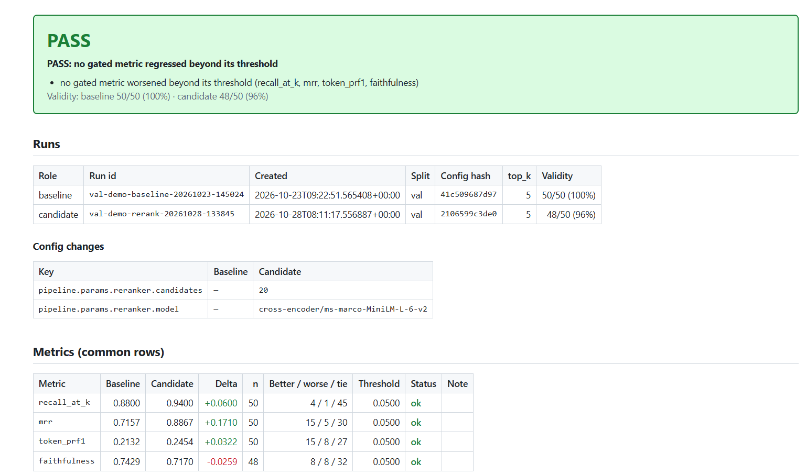
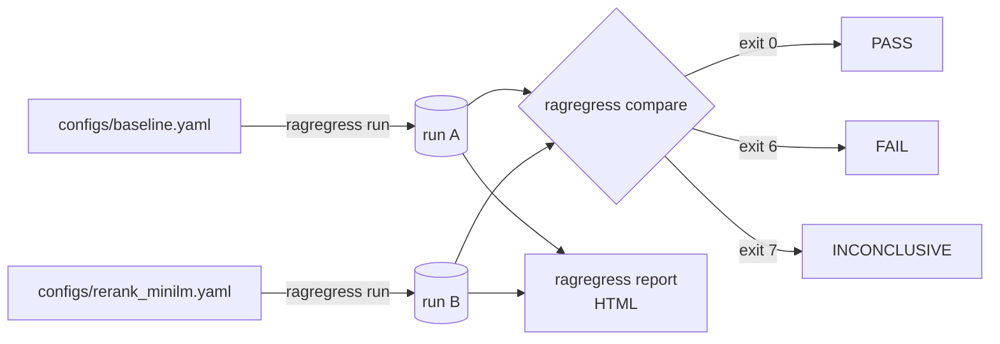
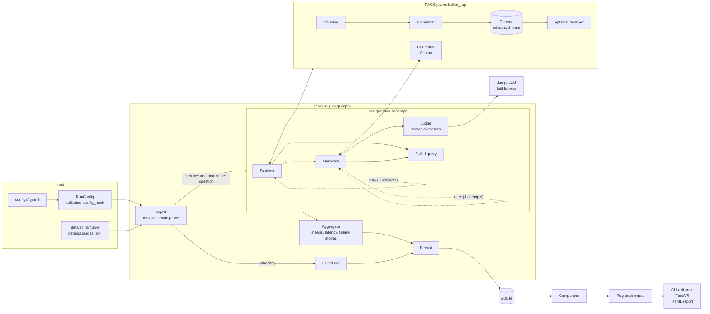

# RAG Regression Lab

**Regression tests for RAG pipelines.** Change a chunk size, swap an embedding model or add a reranker, run the evaluation, and get a CI-style **PASS / FAIL / INCONCLUSIVE** verdict against a stored baseline, plus an HTML report that shows which questions got worse and why.



## Table of contents

- [Overview](#overview)
- [Key features](#key-features)
- [Technology stack](#technology-stack)
- [Architecture](#architecture)
- [Project structure](#project-structure)
- [Prerequisites](#prerequisites)
- [Installation](#installation)
- [Configuration](#configuration)
- [Quick start](#quick-start)
- [CLI reference](#cli-reference)
- [Running with Docker](#running-with-docker)
- [API](#api)
- [Data and storage](#data-and-storage)
- [Evaluation methodology](#evaluation-methodology)
- [Results](#results)
- [Testing your own pipeline](#testing-your-own-pipeline)
- [Observability](#observability)
- [Testing](#testing)
- [Security](#security)
- [Troubleshooting](#troubleshooting)
- [Limitations](#limitations)
- [Roadmap](#roadmap)
- [License and author](#license-and-author)

---

## Overview

**The problem.** Code has regression tests; RAG configurations usually don't. A change that looks harmless can quietly move retrieval rank, answer quality or groundedness. Comparing two runs by eye is unreliable: aggregate means hide per-question losses, and an LLM judge that fails on a few questions can make a worse config look better.

**What this does.** One command evaluates a config on a fixed, seeded question set (SQuAD) and stores every per-question result in SQLite. A second command compares any two stored runs and returns a verdict with an exit code a CI job can gate on. A third writes a self-contained HTML report.



## Key features

- **Config-driven runs.** One YAML file describes an experiment; a `config_hash` over the result-affecting fields identifies it.
- **Four metrics.** Recall@k and MRR (retrieval), SQuAD token F1 (answer correctness), LLM-judged faithfulness (groundedness).
- **Regression gate.** Paired comparison over the questions measured in both runs, a threshold per metric, and an INCONCLUSIVE verdict when either run has too many unmeasured questions.
- **Diagnostics.** Config diff, per-question better/worse/tie counts, failure-mode tags per question, breakdown by category and failure mode, worst-question drill-down with the retrieved passages.
- **HTML report** with target-vs-actual table, latency (p50/p95 per stage) and drill-downs.
- **REST API** (FastAPI): start runs in the background, compare, serve reports.
- **Docker** image and Compose file for the API and the CLI.
- **Structured JSON logs** per run, with secret redaction.
- **Pluggable pipelines** behind a `RAGSystem` interface; a reference pipeline (`builtin_rag`) with an optional cross-encoder reranker.
- **Configurable judge**: local Ollama by default, or any OpenAI-compatible service.

## Technology stack

| Area | Technology |
|---|---|
| Language | Python 3.11 |
| Orchestration | LangGraph (fixed state machine) |
| Generation | Ollama via `langchain-ollama` (`ChatOllama`, temperature 0, seed) |
| Judge | `instructor` + `openai` client against Ollama's OpenAI-compatible endpoint (or any OpenAI-compatible service) |
| Retrieval | Chroma (`langchain-chroma`, `chromadb`), `sentence-transformers` embeddings and cross-encoder reranker, `langchain-text-splitters` for chunking |
| Config and validation | Pydantic v2, PyYAML (`safe_load`) |
| CLI | Typer, tqdm |
| API | FastAPI, uvicorn |
| Storage | SQLite (standard library) |
| Report | Jinja2 (autoescaped, self-contained HTML) |
| Logging | `logging` + `python-json-logger`, redaction filter |
| Data build | Hugging Face `datasets` (SQuAD v1.1) |
| Tests | pytest |
| Packaging | `pyproject.toml` (setuptools), console script `ragregress` |
| Containers | Docker (`python:3.11-slim`, CPU-only torch), Docker Compose |

Exact versions: [`requirements.txt`](requirements.txt) (direct pins), [`requirements.lock`](requirements.lock) (every package in the Docker image).

## Architecture



Before the graph runs, the runner loads the split, builds the RAG system and calls its `ensure_indexed()` (builtin pipeline: rebuilds the Chroma collection only if the chunk fingerprint changed, or with `--reindex`).

| Layer | Responsibility | Main modules |
|---|---|---|
| Config | Validate YAML, compute `config_hash`, resolve the pipeline's params model | `ragregress/core/config.py`, `ragregress/rag/registry.py` |
| Runner | Load data, build the RAG system and metrics, index, run, write the run log | `ragregress/core/runner.py` |
| Pipeline | LangGraph graph: per-question Retrieve → Generate → Judge with retries; aggregate; persist | `ragregress/pipeline/pipeline.py` |
| RAG system | `RAGSystem` interface and the reference implementation | `ragregress/rag/interface.py`, `ragregress/rag/builtin_system.py` |
| Metrics | Metric classes, each declaring its regression threshold | `ragregress/evaluation/metrics/` |
| Judge | Which model judges and where it runs (endpoint and key from the environment) | `ragregress/evaluation/judge.py`, `ragregress/evaluation/structured_llm.py` |
| Comparison | Load two runs, check they are comparable, paired deltas, verdict, diagnostics | `ragregress/evaluation/comparator.py`, `regression.py`, `diagnostics.py` |
| Storage | SQLite schema and repository | `ragregress/storage/` |
| Interfaces | CLI, API, HTML report | `ragregress/cli.py`, `ragregress/main.py`, `ragregress/api/`, `ragregress/report.py` |

Full detail (graphs, storage schema, deployment, limits): [docs/architecture.md](docs/architecture.md).

Design choices:

| Decision | Why |
|---|---|
| Fixed state machine, no agent | A regression tool must do the same steps every time; an agent choosing its own steps would make runs incomparable. |
| Thin, explicit retrieval modules | Chunk size or embedding model change exactly one thing. LangChain is used only as glue (Chroma, Ollama, text splitter). |
| Local models, temperature 0, fixed seeds | No API cost, no data leaves the machine, and the same config reproduces the same per-question scores (see [Reproducibility](#reproducibility)). |
| `config_hash` over result-affecting fields only | Same hash = same experiment. `db_path` and `max_workers` are excluded; an absent optional block (e.g. `reranker`) leaves existing hashes unchanged. |
| INCONCLUSIVE as its own verdict | A broken judge cannot silently pass a change. |
| Ollama on the host, not in a container | Avoids GPU passthrough on Windows; containers reach it through `host.docker.internal`. |

## Project structure

Main paths (not exhaustive):

```text
rag-regression-lab/
├── ragregress/
│   ├── cli.py                 # ragregress run | compare | report
│   ├── main.py                # FastAPI app (uvicorn ragregress.main:app)
│   ├── report.py              # HTML report: context building + rendering
│   ├── templates/index.html   # report template (shipped as package data)
│   ├── api/                   # health.py, experiments.py, schemas.py, settings.py, jobs.py
│   ├── benchmark/             # loader.py (builds data/ from SQuAD), schemas.py
│   ├── core/                  # config.py, runner.py, logging.py, errors.py
│   ├── evaluation/            # comparator.py, regression.py, diagnostics.py, judge.py, structured_llm.py
│   │   └── metrics/           # retrieval_recall/, retrieval_mrr/, token_prf1/, faithfulness/
│   ├── pipeline/              # pipeline.py, pipeline_state.py, pipeline_constants.py, graph.py
│   ├── rag/                   # interface.py, registry.py, builtin_system.py, chunker.py, embedder.py,
│   │                          # retriever.py, reranker.py, generator.py, ...
│   └── storage/               # database.py, repositories.py, models.py
├── configs/
│   ├── baseline.yaml  chunk_1000.yaml  bge_small.yaml  rerank_minilm.yaml  dev.yaml  ...
│   └── targets/squad_val.yaml # target ranges, written before any real run
├── data/                      # passages.json, splits/{dev,val,test}.json, README.md (committed)
├── scripts/                   # check_ollama.py, check_secrets.py, make_lock.py, ...
├── tests/                     # unit/, integration/, security/, fixtures/
├── docs/                      # architecture.md, evaluation.md, security.md, custom_pipeline.md, example report
├── Dockerfile  docker-compose.yml  .dockerignore
├── pyproject.toml  requirements.txt  requirements-dev.txt  requirements.lock
├── .env.example
└── LICENSE                    # MIT
```

Created at runtime (gitignored): `ragregress.db`, `artifacts/chroma/` (vector index), `artifacts/logs/` (run logs), `reports/` (HTML reports).

## Prerequisites

| Requirement | Notes |
|---|---|
| Python 3.11 | `requires-python = ">=3.11"`; developed and tested on 3.11 |
| [Ollama](https://ollama.com) | Runs on the host, also when you use Docker |
| Ollama models | `qwen2.5:3b-instruct` (generator), `qwen2.5:7b-instruct` (judge) |
| Disk | Several GB (Ollama models, torch, embedding and reranker models) |
| GPU | Optional; speeds up embeddings and reranking. The judge dominates run time either way. |
| Docker Desktop | Optional |

The embedding and reranker models (`all-MiniLM-L6-v2`, `BAAI/bge-small-en-v1.5`, `cross-encoder/ms-marco-MiniLM-L-6-v2`) download from Hugging Face on first use.

## Installation

Run every command from the repository root: data, configs, the database and the Chroma index are resolved relative to the working directory.

```powershell
# 1. Ollama models (on the host)
ollama pull qwen2.5:3b-instruct
ollama pull qwen2.5:7b-instruct

# 2. clone and create an isolated environment (.rag_lab_env is the name .gitignore expects)
git clone <repo-url> rag-regression-lab
cd rag-regression-lab
py -3.11 -m venv .rag_lab_env                 # Linux/macOS: python3.11 -m venv .rag_lab_env
.\.rag_lab_env\Scripts\Activate.ps1           # Linux/macOS: source .rag_lab_env/bin/activate

# 3. dependencies, then the package itself (provides the `ragregress` command)
python -m pip install -r requirements-dev.txt
python -m pip install -e . --no-deps

# 4. environment
Copy-Item .env.example .env                   # Linux/macOS: cp .env.example .env
python scripts/check_ollama.py                # exit 0 = Ollama reachable; lists the pulled models
```

- `requirements.txt` holds the runtime pins; `requirements-dev.txt` adds pytest, `datasets` and httpx.
- torch comes from PyPI: CPU build on Windows, CUDA build on Linux. For an NVIDIA GPU on Windows add `--extra-index-url https://download.pytorch.org/whl/cu128`; for CPU only on Linux add `--extra-index-url https://download.pytorch.org/whl/cpu`.

**Data.** The corpus and the splits are committed (`data/passages.json`, `data/splits/{dev,val,test}.json`; see `data/README.md`), so a fresh clone can run immediately. To rebuild them from SQuAD (needs network; overwrites the files):

```powershell
python -m ragregress.benchmark.loader   # 2,067 passages; dev 15 / val 50 / test 200 questions, seed 42
```

## Configuration

### Run config (`configs/*.yaml`)

```yaml
pipeline:
  id: builtin_rag                    # a key of PIPELINE_REGISTRY
  params:                            # validated by that pipeline's params model
    embedding_model: all-MiniLM-L6-v2
    chunk_size: 500                  # 1..4000
    overlap: 50                      # < chunk_size
    generation_model: qwen2.5:3b-instruct
    seed: 42                         # default 42
    reranker:                        # optional; absent = off
      model: cross-encoder/ms-marco-MiniLM-L-6-v2
      candidates: 20                 # >= top_k, <= 50

top_k: 5                             # 1..50
judge_model: qwen2.5:7b-instruct
judge_seed: 42                       # default 42
# judge_provider: ollama             # ollama (default) | openai

eval_split: val                      # dev | val | test
is_dev: false                        # must equal (eval_split == dev)

# operational, not part of config_hash
max_workers: 1                       # 1..8, concurrent questions
db_path: ragregress.db               # run logs go to artifacts/logs/ next to this file
```

Unknown keys are rejected at every level. Shipped configs:

| Config | Change vs `baseline.yaml` |
|---|---|
| `baseline.yaml` | MiniLM-L6, chunk 500 / overlap 50, top-k 5 (val split) |
| `chunk_1000.yaml` | chunk size 1000 |
| `bge_small.yaml` | `BAAI/bge-small-en-v1.5` embeddings |
| `rerank_minilm.yaml` | cross-encoder rerank, 20 candidates → top 5 |
| `dev.yaml` | dev split (15 questions) for quick checks; dev runs cannot be compared |

### Environment variables

Read from the shell or from `.env` in the working directory (a variable already set in the shell wins). The CLI loads `.env` for `run`; the API loads it at startup.

| Variable | Default | Used by |
|---|---|---|
| `OLLAMA_HOST` | `http://localhost:11434` | generator, Ollama judge, `/health`, `check_ollama.py`. Compose sets `http://host.docker.internal:11434`. |
| `LOG_LEVEL` | `WARNING` (`.env.example` sets `INFO`) | console log level: `DEBUG` / `INFO` / `WARNING` / `ERROR`. The run log file always records INFO and up. |
| `JUDGE_BASE_URL` | unset | judge endpoint override (any OpenAI-compatible server); also probed by `/health` |
| `JUDGE_API_KEY` | unset | key for `judge_provider: openai` (falls back to `OPENAI_API_KEY`) |
| `OPENAI_BASE_URL`, `OPENAI_API_KEY` | unset | fallbacks for the `openai` judge provider |
| `RAGREGRESS_SLOW` | unset | `1` enables opt-in tests that use real models |

Judge endpoints and keys are never hashed, stored or logged. `ragregress run --dry-run` prints the resolved judge endpoint and where the key came from, never its value.

Using a hosted or other OpenAI-compatible judge:

```yaml
judge_provider: openai
judge_model: gpt-4o-mini
```
```dotenv
JUDGE_API_KEY=<your-key>
# JUDGE_BASE_URL=https://<your-openai-compatible-server>/v1
```

Changing the judge changes `config_hash`. Comparing runs judged by different models ungates faithfulness, with a warning.

## Quick start

```powershell
ragregress run --config configs/baseline.yaml --dry-run      # validate, print the plan; loads no model
ragregress run --config configs/baseline.yaml                # about 25 min for 50 questions (judge-dominated)
ragregress run --config configs/rerank_minilm.yaml

ragregress compare --baseline <baseline run_id> --candidate <rerank run_id>
ragregress report  --baseline <baseline run_id> --candidate <rerank run_id> --targets configs/targets/squad_val.yaml --open
```

- The run summary prints the `run_id` (default `<split>-<hash8>-<UTC timestamp>`), the index status, failure-mode counts, aggregate metrics and the log file path.
- The first run of a config builds its Chroma collection and downloads the embedding model; later runs reuse both.
- Runs of the same config share `config_hash`, so either can serve as the baseline.

Real output of `ragregress compare --baseline val-demo-baseline-20261023-145024 --candidate val-demo-rerank-20261028-133845` (exit code 0):

```text
baseline : val-demo-baseline-20261023-145024  (hash 41c509687d97, split val, k=5)
candidate: val-demo-rerank-20261028-133845  (hash 2106599c3de0, split val, k=5)

Config changes:
  pipeline.params.reranker.candidates: — -> 20
  pipeline.params.reranker.model: — -> cross-encoder/ms-marco-MiniLM-L-6-v2
  (- = key absent from that run's stored config: legacy run, config incomplete)

Warnings:
  (none)

validity : baseline 50/50 (100%) | candidate 48/50 (96%)
gated    : recall_at_k, mrr, token_prf1, faithfulness

metric           before    after     delta  n    b/w/t       threshold status
recall_at_k      0.8800   0.9400   +0.0600  50   4/1/45      0.05      ok
mrr              0.7157   0.8867   +0.1710  50   15/5/30     0.05      ok
token_prf1       0.2132   0.2454   +0.0322  50   15/8/27     0.05      ok
faithfulness     0.7429   0.7170   -0.0259  48   8/8/32      0.05      ok

VERDICT: PASS
  - no gated metric worsened beyond its threshold (recall_at_k, mrr, token_prf1, faithfulness)
```

`—` means the key is absent from that run's config: here the baseline simply has no `reranker` block (an optional block that is left out when off), not an incomplete config. The legend line is printed whenever a key is absent.
A real generated report (baseline vs rerank_minilm), committed for reviewers who will not run anything: [docs/evaluation_report_example.html](docs/evaluation_report_example.html). Download it and open it locally; GitHub shows HTML files as source.

## CLI reference

`ragregress --help` lists the commands; each has `--help`. Without the console script: `python -m ragregress.cli <command>`.

| Command | Options | Exit codes |
|---|---|---|
| `run` | `--config/-c PATH` (required), `--run-id ID`, `--reindex` (rebuild the Chroma collection), `--dry-run`, `--debug` (traceback on errors) | `0` ok, `3` invalid config or missing data / judge settings, `4` pipeline contract error, `5` run unhealthy (retrieval health probe failed), `1` unexpected |
| `compare` | `--baseline ID`, `--candidate ID` (required), `--db PATH` (default `ragregress.db`), `--worst N` (N worst questions per gated metric + category / failure-mode groups), `--debug` | `0` PASS, `6` FAIL, `7` INCONCLUSIVE, `8` invalid input, `1` unexpected |
| `report` | `--baseline`, `--candidate` (required), `--db`, `--out PATH` (default `reports/<baseline>__vs__<candidate>.html`), `--targets PATH`, `--passages PATH`, `--splits-dir PATH`, `--top N` (drill-downs, default 5), `--open`, `--debug` | `0` written (any verdict), `8` invalid input, `1` unexpected |

Exit code `2` is a usage error (Typer). Gate CI on `compare`; `report` exits 0 whatever the verdict.

Scripts:

| Script | Purpose |
|---|---|
| `scripts/check_ollama.py` | Is Ollama reachable? Lists models; exit 0 / 1 |
| `scripts/check_secrets.py` | Scans tracked files and full git history for secret shapes; exit 0 clean, 1 findings, 2 cannot run |
| `scripts/make_lock.py` | Writes `requirements.lock` from the Docker image: `docker compose run --rm --entrypoint python ragregress scripts/make_lock.py` |
| `scripts/ragas_faithfulness_check.py` | Optional cross-check of faithfulness against Ragas; needs `pip install ragas==0.4.3 langchain-community==0.3.31`; uses `localhost:11434` |

## Running with Docker

```powershell
docker compose build
docker compose up -d                       # API on http://127.0.0.1:8000, docs at /docs
docker compose ps                          # wait for (healthy)
docker compose logs -f api
docker compose down                        # add -v to also delete the index and model-cache volumes
```

The CLI runs from the same image (service `ragregress`, profile `cli`; `up` does not start it):

```powershell
docker compose run --rm ragregress run --config configs/baseline.yaml --dry-run
docker compose run --rm ragregress compare --baseline <id> --candidate <id>
docker compose run --rm --entrypoint python ragregress scripts/check_ollama.py
```

| Item | Where |
|---|---|
| Repo root (data, configs, `ragregress.db`, logs, reports) | bind-mounted at `/work`, shared with runs on the host |
| Chroma index | named volume `chroma_index` → `/work/artifacts/chroma` (separate from the host's `artifacts/chroma`, so the first container run builds its own index) |
| Hugging Face models | named volume `hf_cache` → `/hf-cache` |
| Ollama | the host, via `host.docker.internal` |

- The image runs as a non-root user (uid 1000) with CPU-only torch: retrieval is slower than on a GPU host, results are identical.
- After editing code or `requirements.txt`, rebuild (`docker compose build`): the API runs the installed package, not the mounted source.
- `.env` is read as usual, but `OLLAMA_HOST` from Compose wins. A `JUDGE_BASE_URL` pointing at `localhost` must use `host.docker.internal` inside the container.

## API

Start it with `uvicorn ragregress.main:app` from the repo root (host and port default to `127.0.0.1:8000`), or `docker compose up -d`. Interactive docs: `/docs`.

| Endpoint | Behaviour |
|---|---|
| `GET /health` | Always 200: `{status, ollama_reachable, judge_reachable}`. Probes `OLLAMA_HOST/api/tags` and, if set, `JUDGE_BASE_URL/models` (2 s each; no model call). |
| `GET /runs` | All runs, newest first, dev runs included (`is_dev`); no error text |
| `GET /runs/{run_id}` | Stored run, aggregate metrics and the live job (`state`: `running` / `succeeded` / `failed`, `rows_done`, `rows_total`, `error`); error text redacted; 404 |
| `POST /runs` | Body `{"config": "<name>"}` starts `configs/<name>.yaml` in a background thread. 202 with `run_id` and `status_url`; 404 unknown config; 409 a run is in progress or the id exists; 422 invalid config, or its `db_path` differs from the API's database |
| `POST /compare` | Body `{"baseline": "<id>", "candidates": ["<id>", ...]}` (1–10, unique). 200 even for FAIL / INCONCLUSIVE (verdict in the body); one entry per candidate with `ok`, `error`, `comparison`; 404 unknown baseline; 422 bad body |
| `GET /reports/{baseline}__vs__{candidate}` | HTML report built on each request (`.html` suffix accepted), with the targets table from `configs/targets/squad_val.yaml` when present. 404 unknown run, 400 not comparable, 422 malformed id, 500 broken targets file |

```powershell
Invoke-RestMethod -Method Post -Uri http://127.0.0.1:8000/runs -ContentType application/json -Body '{"config":"rerank_minilm"}'
(Invoke-RestMethod http://127.0.0.1:8000/runs/<run_id>).job
```
```bash
curl -s -X POST http://127.0.0.1:8000/compare -H "Content-Type: application/json" \
  -d '{"baseline":"<id>","candidates":["<id>"]}'
```

There is **no authentication**. Compose publishes the port on `127.0.0.1` only; keep it that way. One API run at a time; job state lives in memory, so a run interrupted by a restart keeps `run_status` null in the database.

## Data and storage

**Dataset.** SQuAD v1.1 `validation` (`rajpurkar/squad`), deduplicated into a 2,067-passage corpus; each question has exactly one gold passage. Three fixed splits sampled once with seed 42 by `ragregress/benchmark/loader.py`: `dev` (15), `val` (50), `test` (200). The splits are independent samples and may overlap. The split files tag each question with a category from a restricted set (`simple`, `simple_with_condition`, `comparison`; `configs/categories_squad.json`), because SQuAD questions are single-passage and extractive.

**SQLite** (`ragregress.db`, created on first use):

| Table | One row per | Main columns |
|---|---|---|
| `runs` | run | `run_id`, `created_at`, `is_dev`, `k`, `max_workers`, `config_json`, `config_hash`, `run_status`, `run_status_detail` |
| `run_metrics` | run × metric | `metric_name`, `value` (metric means, plus `latency_p50_*` / `latency_p95_*` for retrieve, generate, judge, total) |
| `run_query_results` | run × question | `qa_id`, `question`, `query_status`, `failure_mode`, `category`, `last_error`, `retrieved_ids_json`, `gold_ids_json`, `generation_answer`, `metric_results_json`, `latency_json` |

A run's row is written when its questions start, so a crashed run is still visible.

## Evaluation methodology

| Metric | Name in DB / API | Definition | Gate (max tolerated worsening) |
|---|---|---|---|
| Recall@k | `recall_at_k` | gold passage among the top-k retrieved (0 or 1 per question; k = `top_k`) | 0.05 |
| MRR | `mrr` | 1 / rank of the gold passage within the top-k, else 0 | 0.05 |
| Token F1 | `token_prf1` | SQuAD token-level F1 against the best-matching gold answer (labelled "Answer F1" in the targets file) | 0.05 |
| Faithfulness | `faithfulness` | supported claims / extracted claims, judged against the retrieved context (Ragas-style; temperature 0, seed 42, up to 3 retries per judge call) | 0.05 |

Each question also gets a failure-mode tag: `retrieval_miss` (gold not retrieved), `low_faithfulness` (< 0.5), `low_correctness` (token F1 < 0.3), `pass`, `judge_failed` (a metric could not be scored) or `failed` (retrieval or generation failed after 3 attempts, or every metric failed).

Verdict (`ragregress/evaluation/regression.py`):

1. **Invalid input** (unknown run, dev run, different `eval_split`) → error, exit 8.
2. **INCONCLUSIVE** if either run's validity (questions with every gated metric measured ÷ questions attempted) is below 80 %, or a gated metric has no common rows.
3. **FAIL** if any gated metric's paired mean worsened by more than its threshold.
4. Otherwise **PASS**.

Full detail (faithfulness algorithm, row classes, guards, diagnostics, caveats): [docs/evaluation.md](docs/evaluation.md).

A system failure (no answer produced) scores 0 on every metric and counts as measured; an evaluator failure (the answer exists but could not be scored) is unmeasured and lowers validity. Differing `top_k` ungates Recall@k; a differing judge ungates faithfulness (both with a warning).

## Results

Targets were written down **before** any real run (`configs/targets/squad_val.yaml`) and were not adjusted afterwards. Actual values come from stored runs, re-checked against the database on Nov 2, 2026.

| Metric | Target (set in advance) | baseline | chunk_1000 | bge_small | rerank_minilm |
|---|---|---|---|---|---|
| Validity | — | 50/50 | 48/50 | 49/50 | 48/50 |
| Recall@5 | 0.80–0.85 | 0.8800 | 0.9200 (+0.0400) | 0.8800 (0.0000) | **0.9400** (+0.0600) |
| MRR | 0.65–0.75 | 0.7157 | 0.6890 (−0.0267) | 0.8100 (+0.0943) | **0.8867** (+0.1710) |
| Token F1 | 0.55–0.65 | 0.2132 | **0.2530** (+0.0398) | 0.2430 (+0.0297) | 0.2454 (+0.0322) |
| Faithfulness | 0.80–0.90 | 0.7391 | **0.7766** (+0.0375) | 0.7296 (−0.0148) | 0.7170 (−0.0259) |
| Verdict vs baseline | | — | PASS | PASS | PASS |

val split, 50 questions, top-k 5. Values are each run's mean over its common rows with the baseline; deltas are paired. Because the common rows differ per pair, the baseline's faithfulness is 0.7391 / 0.7444 / 0.7429 in the three comparisons (shown: standalone, n = 48).

| Metric | Target vs actual |
|---|---|
| Recall@5 | all configs above target |
| MRR | baseline within; bge_small and rerank_minilm above |
| Token F1 | all far below; likely cause: the generator answers in full sentences with citations stripped, which token F1 against short SQuAD spans penalises (not measured separately) |
| Faithfulness | all below; see [Limitations](#limitations) on judge consistency |

### Reproducibility

The rerank config was run twice: on a Windows host with GPU (Oct 28) and through `POST /runs` in the Linux container on CPU (Nov 2). Same `config_hash`, **identical per-question values on all four metrics** (0 better / 0 worse on every question). Only latency differed: retrieve p50 77 ms (GPU) vs 466 ms (CPU); total p50 about 23 s per question in both, dominated by the judge.

### Failure cases found

- **Judge inconsistency on refusals.** Identical answers and identical refusals were scored 1.0 in one run and 0.0 in another; in the rerank run 9 of 10 refusals scored 0.0. The rerank faithfulness delta is more likely judge noise than a retrieval effect.
- **Reranker can push the gold passage out.** Recall improved overall (4 better / 1 worse); the one loss is the report's worst row. *"What does ctenophore use to capture prey?"* (gold answer: *colloblasts*):

  | | baseline | rerank_minilm |
  |---|---|---|
  | Gold passage | rank 3 (MRR 0.3333) | not in the top 5 |
  | Answer | mentions colloblasts | a generic list of capture techniques, no colloblasts |
  | Recall@5 / Token F1 | 1.0000 / 0.1176 | 0.0000 / 0.0000 |
  | Faithfulness | 1.0000 | 1.0000 |
  | Failure-mode tag | `low_correctness` | `retrieval_miss` |

  Faithfulness stays at 1.0 because the wrong answer is still grounded in what was retrieved: groundedness and correctness are separate metrics for this reason.
- **Judge output that does not fit the schema.** In the rerank run of Nov 2, question `572a07a86aef0514001551d5` got malformed JSON from the 7B judge on all 4 attempts (the claim-verification reply lost its `verdict` field and nested a second `statements` list). Faithfulness for that question is unmeasured, the question is tagged `judge_failed`, and the run's validity is 48/50. The log lines are in [Observability](#observability).

## Testing your own pipeline

Any pipeline that implements the `RAGSystem` interface (`ragregress/rag/interface.py`) can be evaluated:

```python
class RAGSystem(Protocol):
    def retrieve(self, query: str, k: int) -> List[Chunk]: ...            # Chunk.source_passage_id = an id from data/passages.json
    def generate(self, query: str, contexts: List[Chunk]) -> GenerationResult: ...
```

1. Implement the two methods in a class inside the package (optional: `ensure_indexed(passages, force=False)`, which the runner calls before the run).
2. Register it in `ragregress/rag/registry.py` (a params model, a factory, one line).
3. Point a config at it: `pipeline: {id: <your id>, params: {...}}`.
4. `ragregress run --config configs/<name>.yaml`, then `ragregress compare` against another config of the same pipeline.

Metrics, storage, verdicts, the API and the report work unchanged. Step-by-step guide with a runnable example: [docs/custom_pipeline.md](docs/custom_pipeline.md).

## Observability

Every pipeline stage emits one JSON record with `ts`, `level`, `logger`, `event`, `run_id`, `stage`, `query_id`, `attempt`, `status`, `latency_ms`, `tokens_in`, `tokens_out` (currently always null), `error`. Console records go to stderr at `LOG_LEVEL`; every run also appends INFO and up to `artifacts/logs/<run_id>.jsonl` (next to the database), also when the run fails. Every string value is redacted before it is written.

Excerpt from `artifacts/logs/val-2106599c-20261102-102626.jsonl` (real lines; long `error` values shortened with `…`; the always-null `tokens_in` / `tokens_out` and the `exc` traceback fields omitted):

```json
{"run_id": "val-2106599c-20261102-102626", "stage": "run", "query_id": null, "attempt": null, "status": "started", "latency_ms": null, "error": null, "level": "INFO", "logger": "ragregress.pipeline.pipeline", "event": "run started: 50 queries, k=5, max_workers=1, config_hash=2106599c3de0", "ts": "2026-11-02T10:28:09.241231+00:00"}
{"run_id": "val-2106599c-20261102-102626", "stage": "ingest", "query_id": null, "attempt": null, "status": "healthy", "latency_ms": 289.1, "error": null, "level": "INFO", "logger": "ragregress.pipeline.pipeline", "event": "ingest: health probe ok", "ts": "2026-11-02T10:28:09.533983+00:00"}
{"run_id": "val-2106599c-20261102-102626", "stage": "judge", "query_id": "572a07a86aef0514001551d5", "attempt": null, "status": "metric_failed", "latency_ms": null, "error": "faithfulness: InstructorRetryException('2 validation errors for NLIStatementOutput\nstatements.0.verdict\n Field required …')", "level": "WARNING", "logger": "ragregress.pipeline.pipeline", "event": "judge: metric faithfulness crashed", "ts": "2026-11-02T10:42:13.574258+00:00"}
```

Records from third-party libraries (e.g. `instructor`'s own retry error) and from the root logger land in the same file without the pipeline fields (`run_id`, `stage` are null).

```powershell
Get-Content artifacts\logs\<run_id>.jsonl | ConvertFrom-Json | Where-Object stage -eq judge | Select-Object query_id, status, latency_ms
```

Failed questions keep `last_error` and `failure_mode` in SQLite and appear in the report's drill-down.

## Testing

```powershell
python -m pytest -q                                   # unit, integration, security
python -m pytest tests/unit/test_chunker.py -v        # one file
$env:RAGREGRESS_SLOW=1; python -m pytest tests/unit/test_reranker.py -q; Remove-Item Env:RAGREGRESS_SLOW   # opt-in real-model test
```

- **Who the suite is for:** people changing the harness itself. You do not need it to evaluate a pipeline, and adding your own pipeline does not change it: the harness tests use fake RAG systems and judges, and the pipeline-specific tests cover only the built-in `builtin_rag`. For your own pipeline, write a few contract tests ([docs/custom_pipeline.md, step 5](docs/custom_pipeline.md#step-5-test-it)).
- Use `python -m pytest` so the tests run with the active environment's Python.
- Tests use temporary databases and directories (never the real `ragregress.db` or `artifacts/chroma`) and fake models and judges, so they need no Ollama.

| Folder | Covers |
|---|---|
| `tests/unit/` | metrics, config, comparator, regression, report, logging, Docker files, packaging; built-in pipeline only: chunker, retriever, reranker, factory wiring, shipped-config hashes |
| `tests/integration/` | pipeline on fixtures, CLI commands, API (`test_api.py`) |
| `tests/security/` | config validation, malformed judge output, log redaction, secrets exposure |

Last full run on the author's machine (Windows 11, Python 3.11): 871 passed, 3 skipped (opt-in real-model tests), 5 xfailed (known issues pinned with `xfail(strict=True)`), under 2 minutes, in a fresh isolated virtual environment. In a fresh clone, 3 more tests skip: `tests/integration/test_baseline_stability.py` compares against the canonical baseline run stored in the local `ragregress.db`, which is not committed.

## Security

Local-first: no third-party service by default, no API key required. Threat model: bad config, bad judge output, untrusted passage text, secrets leaking through git or logs.

| Guardrail | Where |
|---|---|
| Config validated at the boundary (Pydantic, unknown keys rejected, value caps, YAML `safe_load`) | `tests/security/test_config_validation.py` |
| Judge garbage → bounded retries, then the metric is unmeasured | `tests/security/test_malformed_judge.py` |
| Judge failures cannot pass a comparison (validity < 80 % → INCONCLUSIVE) | `tests/security/test_malformed_judge_pipeline.py` |
| Logs redact e-mails, `sk-`/`ghp_`/`hf_` keys, Bearer tokens, `key=value` secrets | `tests/security/test_log_redaction.py` |
| No secrets in tracked files or git history | `tests/security/test_secrets_check.py`, `test_secrets_exposure.py`, `scripts/check_secrets.py` |
| Judge key from the environment only; excluded from `repr`, the hash and storage | `ragregress/evaluation/judge.py` |
| `POST /runs` accepts a config name (pattern-checked), never a path; error text redacted before it is returned | `ragregress/api/experiments.py`, `ragregress/api/schemas.py` |
| API reachable from this machine only | `docker-compose.yml` (`127.0.0.1:8000:8000`) |

Known open risks: prompt injection through passage text (untested), judge verdict not range-checked (pinned as `xfail`), raw error text stored in SQLite (redacted on API output). Details: [docs/security.md](docs/security.md).

## Troubleshooting

| Symptom | Cause / fix |
|---|---|
| `run` exits 3 with "not found (build the data first ...)" | `data/` is missing: `python -m ragregress.benchmark.loader`. |
| Every question ends `failed` and the summary shows `failed: 50` | The generator cannot reach Ollama (each question fails after 3 attempts). Check with `python scripts/check_ollama.py` and `OLLAMA_HOST`. |
| `run` exits 5 (unhealthy) | The retrieval health probe failed before any question ran, e.g. the embedding model could not be loaded. `--debug` shows the cause. |
| Container cannot reach the judge | `JUDGE_BASE_URL` points at `localhost`; inside a container use `host.docker.internal`. |
| `ModuleNotFoundError` inside the container | Image built from an older `requirements.txt`: `docker compose build`. |
| API still behaves like the old code | The API runs the installed package: `docker compose build` after code changes. |
| `port 127.0.0.1:8000 already in use` | A local `uvicorn` (or another service) holds the port; stop it and retry. |
| `/health` takes a few seconds | Normal when Ollama is down: the 2 s probes time out. |
| First run of a config is slow before the first question | Embedding model download and Chroma index build; later runs reuse both (in Docker: the named volumes, which `down -v` deletes). |
| `compare` exits 8 | Unknown run id, a dev run, different `eval_split`, or `--db` not found; the message says which. |
| `POST /runs` returns 409 | Another API run is in progress, or a run with that id exists (ids end in a seconds timestamp). |
| `—` shows up as `ù` (or another stray character) when CLI output is piped to a file on Windows | Python writes the console code page (cp1252), PowerShell reads it as OEM. Set `$env:PYTHONIOENCODING = "utf-8"` before piping. |
| Tests import the wrong packages | Bare `pytest` may resolve to another Python; use `python -m pytest`. |
| `report --open` does nothing in Docker | A container cannot open your browser; open `reports\*.html` on the host. |
| Linux host: permission denied writing the database | The container runs as uid 1000; the repo root must be writable by it. |

## Limitations

- **Small sample.** 50 questions give little statistical power: read the results as directional. The verdict gates regressions; it does not rank configs.
- **Small local models.** 3B generator, 7B judge.
- **Judge consistency.** The same answer can receive different faithfulness scores; refusals are often scored 0.
- **Easy retrieval benchmark.** One gold passage per question, a small topically distinct corpus, no hybrid retrieval.
- **One run at a time.** The API's guard covers its own process only (a CLI run is not seen); stopping the server stops a run in progress.
- **Report "raw log" links are placeholders** and return 404; the log files themselves are in `artifacts/logs/` for runs made after Oct 29, 2026.
- **Custom pipelines are registered by editing `registry.py`**; comparing two different pipelines is not flagged.
- **Prompt injection is not tested**; passages are pasted into the prompt as plain text.

## Roadmap

Planned, not implemented:

| Item | Where it fits |
|---|---|
| **More evaluation metrics** | a new `Metric` subclass with its own `regression_threshold`, added to `METRIC_REGISTRY` (`ragregress/evaluation/metrics/`); comparison, gating and the report pick it up |
| **Interactive dashboard (Streamlit)** | browse runs, compare configs and drill into questions over the stored SQLite runs or the API |
| **Chunking strategy in the config** | a `strategy` field for the built-in pipeline's chunker (today: fixed-size windows only), part of `pipeline.params` and therefore of `config_hash` |
| **Versioned generator prompt** | a `prompt_version` in the built-in pipeline's config, so prompt changes are tracked experiments; then prompt hardening and a prompt-injection test |

Also planned:
- Serve per-question logs from the API and link them from the report.
- Range-check the judge verdict (`Literal[0, 1]`); a judge-agreement mode.
- Plugin entry point for custom pipelines; a benchmark mode for comparing different pipelines.
- Token counts in the logs; hybrid search; a larger evaluation set; a CI bot that comments the verdict on pull requests.

## License and author

Released under the [MIT License](LICENSE). Author: Chaitanya Deo.

Acknowledgements: [SQuAD](https://rajpurkar.github.io/SQuAD-explorer/) (Rajpurkar et al.), [Ragas](https://github.com/explodinggradients/ragas) (faithfulness method), [Ollama](https://ollama.com), [LangGraph](https://github.com/langchain-ai/langgraph), [Chroma](https://www.trychroma.com), [sentence-transformers](https://www.sbert.net).