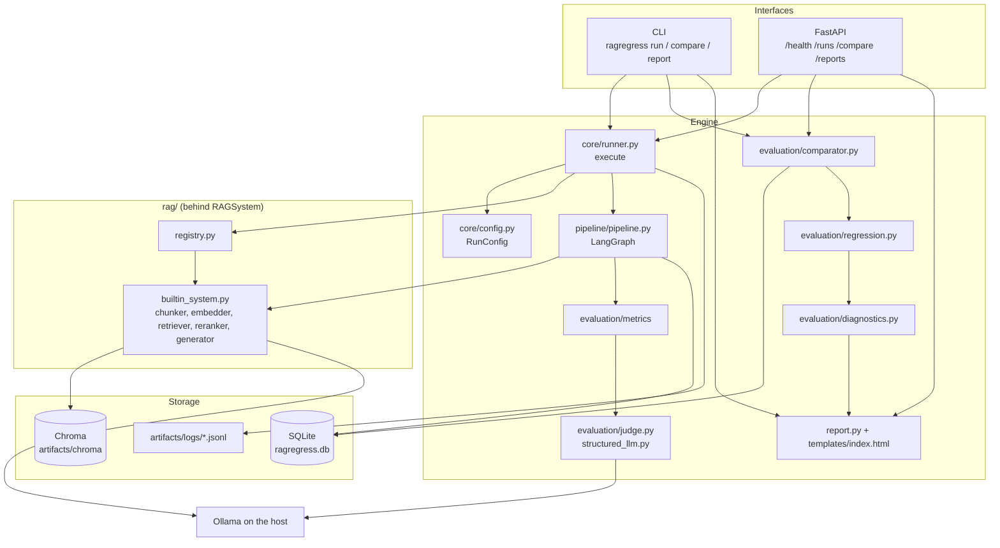
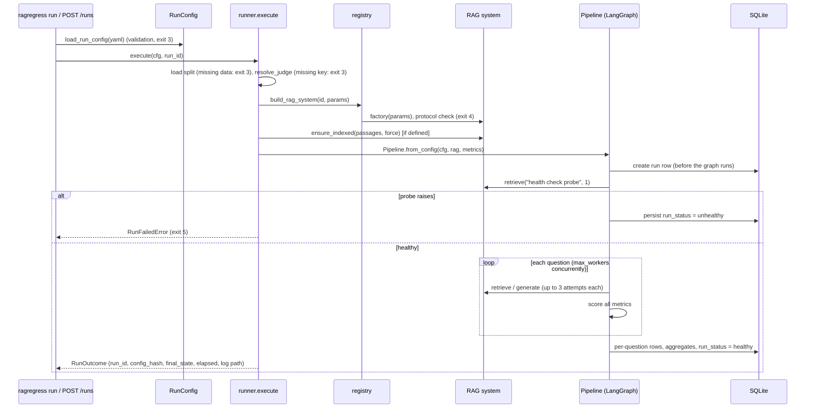
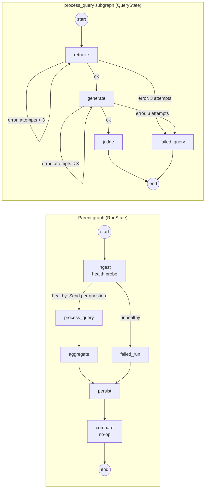
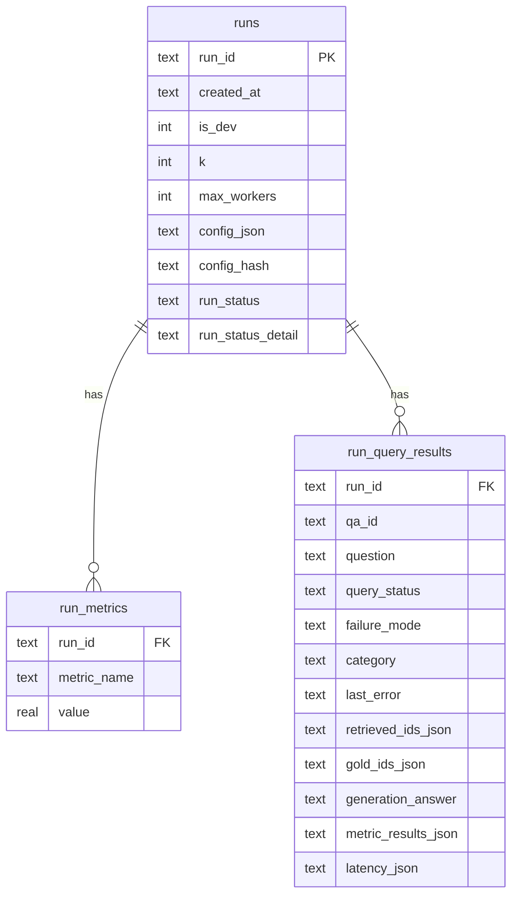
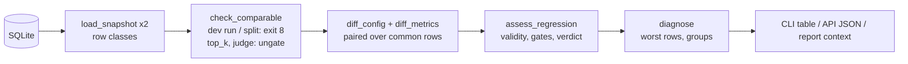
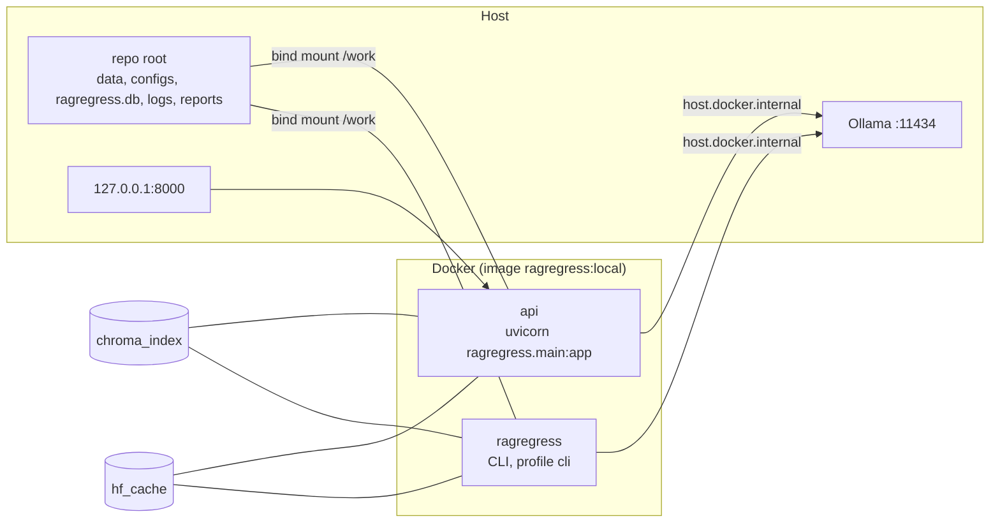

# Architecture

How RAG Regression Lab is built: the layers, how a run flows through them, and why each part is shaped the way it is. For installation and usage see the [README](../README.md); for metrics and verdicts see [evaluation.md](evaluation.md).

## Contents

1. [Overview](#1-overview)
2. [Layers and modules](#2-layers-and-modules)
3. [A run, end to end](#3-a-run-end-to-end)
4. [The pipeline graph (LangGraph)](#4-the-pipeline-graph-langgraph)
5. [The RAG system seam](#5-the-rag-system-seam)
6. [The built-in pipeline](#6-the-built-in-pipeline)
7. [The judge](#7-the-judge)
8. [Configuration and `config_hash`](#8-configuration-and-config_hash)
9. [Storage](#9-storage)
10. [Comparison, verdict and diagnostics](#10-comparison-verdict-and-diagnostics)
11. [Interfaces: CLI, API, report](#11-interfaces-cli-api-report)
12. [Logging](#12-logging)
13. [Deployment (Docker)](#13-deployment-docker)
14. [Design decisions](#14-design-decisions)
15. [Known architectural limits](#15-known-architectural-limits)

## 1. Overview



Three properties shape everything else:

- **Runs are stored, comparisons are computed.** A run writes every per-question result to SQLite once; any two stored runs can be compared later without re-running anything.
- **The pipeline under test sits behind one interface.** The harness only calls `retrieve()` and `generate()`; everything specific to the built-in pipeline lives under `ragregress/rag/`.
- **Pure logic in the middle, I/O at the edges.** Comparator, regression gate, diagnostics and report-context building take data and return data; the CLI, the API and the runner do the reading and writing.

## 2. Layers and modules

| Layer | Module | Responsibility |
|---|---|---|
| Config | `core/config.py` | `RunConfig` (Pydantic v2, frozen, `extra="forbid"`), `load_run_config()`, `config_hash()` |
| Errors | `core/errors.py` | `RagRegressError` family; each class carries its CLI exit code |
| Runner | `core/runner.py` | `execute()`: load data, check judge settings, build RAG system, index, build metrics and pipeline, run, write the run log |
| Logging | `core/logging.py` | JSON formatter, redaction, console handler, per-run log file |
| Pipeline | `pipeline/pipeline.py`, `pipeline_state.py`, `pipeline_constants.py` | LangGraph graphs, per-question state, aggregation, persistence |
| RAG contract | `rag/interface.py` | `RAGSystem` protocol, `Chunk`, `GenerationResult` |
| Registry | `rag/registry.py` | pipeline id → (params model, factory); protocol check |
| Built-in pipeline | `rag/builtin_system.py`, `chunker.py`, `embedder.py`, `retriever.py`, `reranker.py`, `generator.py` | the reference RAG pipeline |
| Metrics | `evaluation/metrics/` | `RecallAtK`, `MRR`, `TokenPRF1`, `Faithfulness`, `METRIC_REGISTRY` |
| Judge | `evaluation/judge.py`, `structured_llm.py` | provider / endpoint / key resolution; `instructor`-based structured output |
| Comparison | `evaluation/comparator.py`, `regression.py`, `diagnostics.py` | load and check two runs, verdict, worst rows and groups |
| Storage | `storage/database.py`, `repositories.py`, `models.py` | schema, migrations, read/write |
| Data | `benchmark/loader.py`, `schemas.py` | build `data/` from SQuAD; `Passage`, `QAPair` |
| Interfaces | `cli.py`, `main.py`, `api/*`, `report.py`, `templates/index.html` | Typer CLI, FastAPI app, HTML report |

## 3. A run, end to end



- The run id defaults to `<split>-<first 8 of config_hash>-<UTC timestamp>`.
- The run row is written before the graph starts, so a crashed run is still visible (with `run_status` null).
- The whole run is wrapped in `run_log_file()`, so every INFO+ record goes to `artifacts/logs/<run_id>.jsonl`, also when the run fails.

## 4. The pipeline graph (LangGraph)

Two compiled graphs. The parent works on run-level state (`RunState`); each question runs in its own invocation of a subgraph with question-level state (`QueryState`), dispatched with `Send()`.



| Node | What it does |
|---|---|
| `ingest` | Calls `retrieve("health check probe", k=1)`; sets `run_status` healthy or unhealthy |
| `retrieve` | `rag_system.retrieve(question, k=top_k)`; records latency; on error increments the retry count |
| `generate` | `rag_system.generate(question, chunks)`; same retry handling |
| `judge` | Scores every configured metric. A crashing metric is logged and left out (the row stays `judged`, tagged `judge_failed` later); if every metric crashes, the row becomes `failed` |
| `failed_query` | Terminal node after 3 failed attempts; row `failed` with `last_error` |
| `aggregate` | Mean of each metric over judged rows (NaN dropped); latency p50 / p95 per stage and total; failure-mode tags |
| `persist` | Writes per-question rows, aggregates and the final run status |
| `compare` | Placeholder (returns nothing); comparison is done by the comparator on stored runs |

Notes:
- Per-question results flow back through a list reducer (`per_query_results`, `operator.add`) at both levels, so concurrent branches never write the same channel.
- `max_workers` maps to LangGraph's `max_concurrency`.
- If the metric set needed no generation, `retrieve` would route straight to `judge`; with the four standard metrics generation always runs.
- Every node emits one structured log record (see [Logging](#12-logging)).

## 5. The RAG system seam

```python
class RAGSystem(Protocol):                     # ragregress/rag/interface.py
    def retrieve(self, query: str, k: int) -> List[Chunk]: ...
    def generate(self, query: str, contexts: List[Chunk]) -> GenerationResult: ...
```

- `Chunk.source_passage_id` must be a corpus id from `data/passages.json`: retrieval metrics compare it with the gold id.
- `GenerationResult.answer` is what the answer metrics score.
- An optional `ensure_indexed(passages, force)` is called by the runner when present.

`ragregress/rag/registry.py` maps a pipeline id to a params model and a factory:

| Piece | Role |
|---|---|
| `PipelineParams` | base model: `extra="forbid"`, frozen |
| `PIPELINE_REGISTRY` | `{"builtin_rag": PipelineEntry(BuiltinRAGParams, _build_builtin_rag)}` |
| `build_rag_system(id, params)` | runs the factory, checks `isinstance(system, RAGSystem)` (`PipelineContractError`, exit 4) |

`RunConfig` validates `pipeline.params` against the registered params model at load time, so an unknown id or an unknown parameter is a config error (exit 3). Factories import their pipeline lazily, so loading a config never pulls in heavy dependencies. How to add a pipeline: [custom_pipeline.md](custom_pipeline.md).

## 6. The built-in pipeline

`BuiltinRAGSystem` (`rag/builtin_system.py`) wires five small modules:

| Module | Implementation | Configured by |
|---|---|---|
| `chunker.py` | fixed-size character windows (`CharacterTextSplitter(separator="")`); chunk id `<passage_id>::<n>` | `chunk_size`, `overlap` |
| `embedder.py` | `sentence-transformers` model, plus an adapter so Chroma can call it | `embedding_model` |
| `retriever.py` | Chroma collection under `artifacts/chroma`, named `passages_<model>_<chunk_size>_<chunker fingerprint>` | derived |
| `reranker.py` | optional cross-encoder: vector search returns `max(candidates, k)` chunks, the cross-encoder keeps the best `k` | `reranker.model`, `reranker.candidates` |
| `generator.py` | `ChatOllama` (temperature 0, seed), prompt that requires `[source: p…]` citations and a fixed abstention sentence; citations are parsed out and stripped from `answer` | `generation_model`, `seed` |

**Indexing** (`ensure_indexed`): the collection stores a content fingerprint (hash of all chunk ids and texts). It is rebuilt from scratch when `--reindex` is given, when no fingerprint is stored, when the fingerprint differs (chunking code or corpus changed), or when the chunk count differs; otherwise nothing is embedded. Reranking never touches the index, so `rerank_minilm` reuses the baseline collection.

## 7. The judge

| Piece | Behaviour |
|---|---|
| What judges | `judge_provider` (`ollama` default, or `openai`) + `judge_model`, from the config (hashed) |
| Where it runs | `resolve_judge()` reads `JUDGE_BASE_URL`, `OLLAMA_HOST`, `OPENAI_BASE_URL`; key from `JUDGE_API_KEY` / `OPENAI_API_KEY`. Never hashed, stored or logged; the key is excluded from `repr`. |
| Client | `InstructorStructuredLLM`: `instructor` in JSON mode over an OpenAI-compatible endpoint, temperature 0, `judge_seed`, `max_retries=3` (up to 4 requests per call) |
| Fail fast | the runner resolves the judge before loading any model, so a missing key is exit 3 at once |

Any OpenAI-compatible service works as `judge_provider: openai` plus `JUDGE_BASE_URL`. Providers are implemented in `judge.py`; it is deliberately not a plug-in point.

## 8. Configuration and `config_hash`

```yaml
pipeline: {id: builtin_rag, params: {...}}     # owned by the pipeline under test
top_k: 5                                       # harness fields
judge_model: qwen2.5:7b-instruct
judge_seed: 42
eval_split: val
is_dev: false
max_workers: 1                                 # operational, not hashed
db_path: ragregress.db                         # operational, not hashed
```

- `config_hash()` = SHA-256 of the canonical JSON dump without `db_path` and `max_workers`. Same hash = same experiment.
- Serializers keep hashes stable as features are added: an absent `reranker` block, an absent `chunking` block (or `chunking: {strategy: fixed}`, which is the same thing) and the default `judge_provider: ollama` are omitted from the dump, so configs written before those fields existed keep their hashes (pinned by tests). The Chroma collection name follows the same rule: the chunk fingerprint leaves out `strategy` and `options` for `fixed`, so existing indexes keep their names.
- Validation rules: `is_dev` must equal `eval_split == "dev"`; `reranker.candidates >= top_k`; `chunking` is a union discriminated by `strategy`, `sliding_window` requires `overlap: 0` and `stride <= window`; caps on `top_k` (≤ 50), `chunk_size` (≤ 4000), `max_workers` (≤ 8).

## 9. Storage

SQLite, created and migrated by `init_db()` (idempotent; additive migrations).



- `metric_results_json` holds value and reason per metric; chunk text, raw LLM output and citations are not stored.
- Runs written before `RunConfig` existed have no `pipeline` key in their config ("legacy"); the comparator still reads them, with a warning.

## 10. Comparison, verdict and diagnostics



| Step | Module | Output |
|---|---|---|
| Load | `comparator.load_snapshot` | each row classified as measured, system failure (scored 0) or evaluator failure (unmeasured) |
| Guard | `comparator.check_comparable` | errors (exit 8), warnings, metrics to ungate |
| Diff | `comparator.compare_runs` | config changes, per-metric paired means and better/worse/tie counts over common rows |
| Verdict | `regression.assess_regression` | PASS / FAIL / INCONCLUSIVE, reasons, exit code (0 / 6 / 7) |
| Diagnostics | `diagnostics.diagnose` | top-N worst rows per gated metric, groups by category and failure mode |

Thresholds are declared on each metric class (`regression_threshold`, `higher_is_better`), so the gate is read from the metric itself. Rules in detail: [evaluation.md](evaluation.md#6-comparison-and-verdict).

## 11. Interfaces: CLI, API, report

| Interface | Notes |
|---|---|
| CLI (`cli.py`, Typer) | thin: parse options, call the engine, print, map exceptions to exit codes; `run` loads `.env` and sets up console logging |
| API (`main.py`, `api/`) | `create_app(settings, executor, configure)`; routers `health` and `experiments`; `ApiSettings` holds relative paths (DB, configs, data, targets) |
| Background runs | `api/jobs.py`: one daemon thread per run, one run at a time per process (409 otherwise); job state (`running` / `succeeded` / `failed`, rows done) lives in memory; error text redacted |
| Report (`report.py`) | `generate_report()` reads the DB and data files and builds a `ReportContext` of plain strings; `render_html()` uses Jinja2 with autoescape and `StrictUndefined`; output is one self-contained HTML file (no scripts, no external assets) |

API reports are built on each request and not stored. The template is shipped as package data, so non-editable installs (the Docker image) include it.

## 12. Logging

| Piece | Behaviour |
|---|---|
| Format | JSON per line: `ts, level, logger, event, run_id, stage, query_id, attempt, status, latency_ms, tokens_in, tokens_out, error` (+ `exc`) |
| Console | stderr, level from `LOG_LEVEL` (default WARNING) |
| Run file | `artifacts/logs/<run_id>.jsonl` next to the database, INFO and up, appended while the run executes |
| Redaction | `RedactingFilter` on every handler plus value-level redaction in the formatter: e-mails, `sk-` / `ghp_` / `hf_` keys, Bearer tokens, `key=value` secrets |
| Library code | modules only call `logging.getLogger(__name__)`; handlers are installed by entry points |

The run file attaches to the root logger, so records from libraries (e.g. `instructor`) land there too, without the pipeline fields.

## 13. Deployment (Docker)



- Image: `python:3.11-slim`, CPU-only torch, pinned requirements, the package installed non-editable, non-root user (uid 1000), `.dockerignore` allow-list.
- `api` runs the installed package (`--app-dir /app` keeps the mounted source off the import path), so code changes need `docker compose build`.
- The port is published on `127.0.0.1` only; the healthcheck calls `/health`.
- `requirements.lock` is generated from the image by `scripts/make_lock.py`.

## 14. Design decisions

| Decision | Alternative considered | Why |
|---|---|---|
| Fixed LangGraph state machine | an agent | identical steps on every run; comparability |
| Store per-question rows; compare later | compute deltas during the run | any pair of runs comparable at any time; paired statistics |
| Paired means over common rows | compare run aggregates | a few failed questions cannot shift a comparison |
| INCONCLUSIVE verdict | treat unmeasured rows as 0 or ignore them | a broken judge must not pass or fail a change silently |
| Thresholds on the metric classes | a global table | a new metric carries its own gate |
| Thin hand-written retrieval modules | a full LangChain chain | the variable under test (chunk size, model) changes exactly one thing |
| Judge provider in config, endpoint and key in env | everything in config | hash identifies the experiment; secrets never stored |
| Ollama on the host | Ollama in a container | GPU access on Windows without passthrough setup |
| Registry for pipelines | hard-wired pipeline | other pipelines can be evaluated without rearchitecture |

## 15. Known architectural limits

| Limit | Effect |
|---|---|
| Health probe calls only `retrieve` | if the generator (Ollama) is down, the run stays healthy and every question ends `failed` |
| Job guard is per process | a CLI run and an API run can overlap; stopping the API stops its run |
| Paths are relative to the working directory | commands must run from the repo root (Chroma index path, data, configs) |
| `compare` node is a placeholder | in-run comparison is not implemented; use the comparator on stored runs |
| Pipelines are registered in source | no plugin entry point; comparing different pipelines is not flagged |
| Report log links | the per-question "raw log" link works only in an API-served report (`GET /runs/{run_id}/logs`); a CLI-written report shows the log file path |