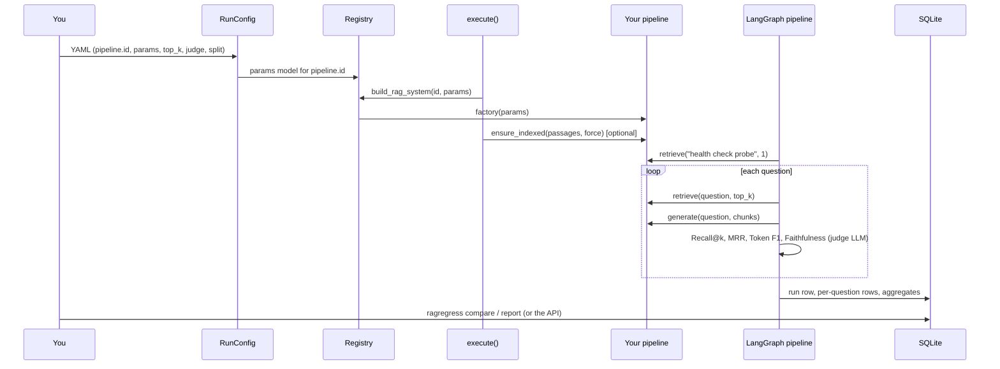

# Custom pipelines

How to evaluate your own RAG pipeline with RAG Regression Lab: what to implement, how to register it, and a complete runnable example that goes from pipeline to verdict and HTML report.

Back to the [main README](../README.md).

## Table of contents

1. [Overview](#1-overview)
2. [What is a custom pipeline?](#2-what-is-a-custom-pipeline)
3. [When to use it](#3-when-to-use-it)
4. [How it works](#4-how-it-works)
5. [Architecture and workflow](#5-architecture-and-workflow)
6. [Prerequisites](#6-prerequisites)
7. [Installation and setup](#7-installation-and-setup)
8. [Environment configuration](#8-environment-configuration)
9. [Required parameters and configuration](#9-required-parameters-and-configuration)
10. [Step-by-step implementation](#10-step-by-step-implementation)
11. [Complete runnable example](#11-complete-runnable-example)
12. [How to execute the example](#12-how-to-execute-the-example)
13. [Expected output](#13-expected-output)
14. [Metrics integration](#14-metrics-integration)
15. [Storage integration](#15-storage-integration)
16. [Verdict generation](#16-verdict-generation)
17. [API integration](#17-api-integration)
18. [Report generation](#18-report-generation)
19. [Customization options](#19-customization-options)
20. [Troubleshooting](#20-troubleshooting)
21. [Common errors and solutions](#21-common-errors-and-solutions)
22. [Related documentation](#22-related-documentation)

---

## 1. Overview

The harness never calls a chunker, an embedder or an LLM directly. It calls two methods on an object that satisfies the `RAGSystem` protocol: `retrieve()` and `generate()`. The built-in pipeline (`builtin_rag`) is one such object. Yours can be another; once it is registered under an id, a config selects it with `pipeline.id`, and metrics, storage, comparison, verdicts, the API and the report work unchanged.

## 2. What is a custom pipeline?

Three pieces:

| Piece | What it is | Where it lives |
|---|---|---|
| A class | implements `retrieve(query, k)` and `generate(query, contexts)` | any module importable from the package (or your script) |
| A params model | a Pydantic model (subclass of `PipelineParams`) listing the pipeline's knobs | next to the registry entry |
| A registry entry | `PIPELINE_REGISTRY["<id>"] = PipelineEntry(ParamsModel, factory)` | `ragregress/rag/registry.py`, or added at runtime in your own process |

## 3. When to use it

- You have your own retrieval or generation stack and want regression checks across its configs (index type, prompt, model, top-k, ...).
- You want to compare a change in your pipeline against a stored baseline of the same pipeline, with the same metrics and gate.

Not a fit (today):
- A corpus other than SQuAD: scoring uses the passages and gold ids in `data/`.
- Choosing between two unrelated pipelines: comparison is designed for configs of one pipeline (see [Verdict generation](#16-verdict-generation)).

## 4. How it works

1. `RunConfig` (`ragregress/core/config.py`) validates the YAML. `pipeline.params` is validated against the params model registered for `pipeline.id`; unknown ids and unknown keys are rejected (exit 3).
2. `execute()` (`ragregress/core/runner.py`) loads the split, checks the judge settings, then calls `build_rag_system()` (`ragregress/rag/registry.py`), which runs your factory and checks that the result has `retrieve` and `generate` (exit 4 if not).
3. If your object has `ensure_indexed(passages, force=...)`, the runner calls it with every passage from `data/passages.json` (`force=True` with `--reindex`). Otherwise indexing is your pipeline's business.
4. The LangGraph pipeline (`ragregress/pipeline/pipeline.py`) first calls `retrieve("health check probe", k=1)`. If that raises, the run is unhealthy (exit 5). Otherwise every question goes through Retrieve → Generate → Judge, with up to 3 attempts for `retrieve` and for `generate`.
5. The four metrics score each question; results go to SQLite; `compare` and `report` work on the stored runs.

## 5. Architecture and workflow



## 6. Prerequisites

| Requirement | Why |
|---|---|
| Repository installed (`python -m pip install -r requirements-dev.txt` and `python -m pip install -e . --no-deps`) | imports `ragregress`; see [Installation](../README.md#installation) |
| `data/passages.json` and `data/splits/<split>.json` | the corpus and questions (`python -m ragregress.benchmark.loader` builds them) |
| Ollama with the judge model (`ollama pull qwen2.5:7b-instruct`) | faithfulness is LLM-judged, whatever your pipeline does |
| Commands run from the repository root | data, configs, the database and logs resolve relative to it |

Your own pipeline's dependencies are yours to install.

## 7. Installation and setup

Nothing extra to install for the example below: it uses only the standard library, Pydantic and `ragregress`.

Two ways to make a pipeline known to the harness:

| Option | How | CLI `ragregress run` | API `POST /runs` | Stored runs usable by `compare`, `report`, API compare/report |
|---|---|---|---|---|
| A. Runtime registration (the example) | add the entry to `PIPELINE_REGISTRY` in your script, then call `execute()` | no | no | yes |
| B. Permanent registration | edit `ragregress/rag/registry.py` | yes | yes (rebuild the Docker image) | yes |

Option A changes nothing in the package and is the fastest way to try a pipeline. Use option B once you want the CLI, the API and Docker to run it ([step 2](#step-2-register-it)).

## 8. Environment configuration

The judge reads its endpoint from the environment (`.env` in the repo root, or the shell). Your pipeline reads whatever it needs itself.

| Variable | Required | Purpose |
|---|---|---|
| `OLLAMA_HOST` | no (default `http://localhost:11434`) | where the Ollama judge (and the built-in generator) run |
| `JUDGE_BASE_URL` | no | any OpenAI-compatible judge endpoint |
| `JUDGE_API_KEY` | only with `judge_provider: openai` and no base URL | judge key, e.g. `JUDGE_API_KEY=<your-key>`; never stored or logged |
| `LOG_LEVEL` | no (default `WARNING`) | console log level; the per-run log file always records INFO and up |

## 9. Required parameters and configuration

A run config has harness fields (top level) and pipeline fields (`pipeline`):

| Field | Required | Notes |
|---|---|---|
| `pipeline.id` | yes | the registry key |
| `pipeline.params` | yes | validated by your params model; every field goes into `config_hash` |
| `top_k` | yes | 1..50; passed to `retrieve(query, k)` |
| `judge_model` | yes | e.g. `qwen2.5:7b-instruct` |
| `eval_split` | yes | `dev`, `val` or `test` |
| `is_dev` | yes | must be `true` exactly when `eval_split` is `dev` |
| `judge_provider` | no | `ollama` (default) or `openai` |
| `judge_seed` | no | default 42 |
| `max_workers` | no | 1..8, questions processed concurrently; above 1 your pipeline must be thread-safe |
| `db_path` | no | default `ragregress.db` |

Params model rules (inherited from `PipelineParams`): unknown keys are rejected and the model is frozen. Put every knob that changes results in it, and nothing else, so `config_hash` identifies the experiment.

## 10. Step-by-step implementation

### Step 1: implement the class

```python
from typing import List
from ragregress.rag.interface import Chunk, GenerationResult

class MyRAG:
    def retrieve(self, query: str, k: int) -> List[Chunk]: ...
    def generate(self, query: str, contexts: List[Chunk]) -> GenerationResult: ...
```

| Return value | Field | Used by the harness |
|---|---|---|
| `Chunk` | `source_passage_id` | **must be a `passage_id` from `data/passages.json`**: Recall@k and MRR compare it with the gold id, the report looks the passage up by it |
| | `text` | the context the faithfulness judge checks claims against (not stored) |
| | `chunk_id`, `metadata` | not used by the harness |
| `GenerationResult` | `answer` | scored by Token F1 and faithfulness, stored as `generation_answer` |
| | `raw_output`, `citations` | not stored, not scored |

Rules:
- Return at most `k` chunks, best first (only the first `k` are scored; MRR uses the order).
- Return a non-empty `answer`: an empty one cannot be judged, so faithfulness is unmeasured for that question.
- Raising is allowed: the question is retried, then stored as `failed` and scored 0.
- Optional: `ensure_indexed(self, passages, force=False) -> int` (passages are `ragregress.benchmark.schemas.Passage` objects with `passage_id`, `title`, `text`; return the number of chunks indexed, 0 if up to date).
- For reproducible runs: fixed seeds, temperature 0, deterministic tie-breaking.

### Step 2: register it

Option B, permanent: in `ragregress/rag/registry.py`, next to the built-in entry (`Field`, `Dict`, `PipelineParams`, `PipelineEntry` and `RAGSystem` are already imported there):

```python
class MyRAGParams(PipelineParams):
    """Knobs of MyRAG. Every field is part of config_hash."""
    index_name: str = Field(min_length=1)
    temperature: float = Field(default=0.0, ge=0.0, le=2.0)


def _build_my_rag(params: MyRAGParams) -> RAGSystem:
    from ragregress.rag.my_rag import MyRAG          # lazy import: loaded only when this pipeline runs
    return MyRAG(index_name=params.index_name, temperature=params.temperature)


PIPELINE_REGISTRY: Dict[str, PipelineEntry] = {
    "builtin_rag": PipelineEntry(BuiltinRAGParams, _build_builtin_rag),
    "my_rag": PipelineEntry(MyRAGParams, _build_my_rag),
}
```

With an editable install nothing needs reinstalling; the Docker image must be rebuilt (`docker compose build`). Option A is shown in the [example](#11-complete-runnable-example).

### Step 3: write a config

`configs/my_rag.yaml`:

```yaml
pipeline:
  id: my_rag
  params:
    index_name: squad-v1
    temperature: 0.0

top_k: 5
judge_model: qwen2.5:7b-instruct
judge_seed: 42

eval_split: val
is_dev: false
```

### Step 4: run, compare, report

```powershell
ragregress run --config configs/my_rag.yaml --dry-run    # validates; prints the params, config_hash and data files
ragregress run --config configs/my_rag.yaml
ragregress compare --baseline <run_id> --candidate <run_id>
ragregress report  --baseline <run_id> --candidate <run_id> --targets configs/targets/squad_val.yaml
```

### Step 5: test it

The project's own test suite does not cover your pipeline (it tests the harness with fakes, plus the built-in pipeline) and does not change when you add one. Add a few contract tests for yours, for example `tests/unit/test_my_rag.py`; they check what the harness relies on and run without a judge:

```python
"""Contract checks for a custom pipeline. Adapt the import and the constructor call."""

import json
from pathlib import Path

import pytest

from ragregress.rag.interface import RAGSystem
from ragregress.rag.my_rag import MyRAG                       # <- your class

CORPUS_IDS = {p["passage_id"] for p in json.loads(Path("data/passages.json").read_text(encoding="utf-8"))}
QUESTION = "When did Apollo 11 land on the Moon?"
K = 5


@pytest.fixture(scope="module")
def rag():
    return MyRAG()                                            # <- your constructor arguments


def test_satisfies_the_protocol(rag):
    assert isinstance(rag, RAGSystem)


def test_retrieve_returns_at_most_k_corpus_passages(rag):
    chunks = rag.retrieve(QUESTION, K)
    assert 0 < len(chunks) <= K
    assert {c.source_passage_id for c in chunks} <= CORPUS_IDS   # not your internal chunk ids


def test_health_probe_query_does_not_raise(rag):
    rag.retrieve("health check probe", 1)                     # the pipeline calls this before every run


def test_generate_returns_a_non_empty_answer(rag):
    assert rag.generate(QUESTION, rag.retrieve(QUESTION, K)).answer.strip()


def test_is_deterministic(rag):
    first = rag.retrieve(QUESTION, K)
    assert rag.retrieve(QUESTION, K) == first
    assert rag.generate(QUESTION, first).answer == rag.generate(QUESTION, first).answer
```

```powershell
python -m pytest tests/unit/test_my_rag.py -v
```

| Check | Why the harness needs it |
|---|---|
| protocol | `build_rag_system` rejects anything else (exit 4) |
| corpus ids, at most `k` | Recall@k and MRR compare `source_passage_id` with the gold id |
| health-probe query | a raise here makes the whole run unhealthy (exit 5) |
| non-empty answer | an empty answer cannot be judged (faithfulness unmeasured) |
| determinism | otherwise deltas between runs mix your change with noise |

If your pipeline calls an LLM, the generate and determinism tests need it running; mark them opt-in as the project does (`RAGREGRESS_SLOW=1`), or fake the LLM. For a config, it is also worth pinning that `pipeline.params` validates and that `config_hash` changes when a knob changes.

## 11. Complete runnable example

A keyword-overlap pipeline: it retrieves the passages sharing the most words with the question and answers with the best-matching sentence of the top passage. No embeddings and no LLM, so only the judge needs Ollama. The script registers the pipeline at runtime (option A), runs it through the same `execute()` the CLI uses, compares two configs (`min_word_len` 3 vs 4), prints the verdict and writes the HTML report.

Save as `scripts/custom_pipeline_example.py`:

```python
"""
scripts/custom_pipeline_example.py

A custom RAG pipeline evaluated by RAG Regression Lab, end to end, without editing the package:
register -> configure -> run (x2) -> compare -> verdict -> HTML report.

    python scripts/custom_pipeline_example.py --split dev    # smoke test: 1 run, 15 questions, no comparison
    python scripts/custom_pipeline_example.py --split val    # 2 runs (min_word_len 3 vs 4), compare, report

Needs: the package installed (pip install -e .), data/ built, Ollama running with the judge model.
The pipeline itself needs no LLM. Run from the repository root.
"""

from __future__ import annotations

import argparse
import json
import re
from collections import Counter
from pathlib import Path
from typing import List, Set

from dotenv import find_dotenv, load_dotenv
from pydantic import Field

from ragregress.core.config import RunConfig
from ragregress.core.runner import execute
from ragregress.evaluation.comparator import compare_runs
from ragregress.evaluation.regression import assess_regression
from ragregress.rag.interface import Chunk, GenerationResult, RAGSystem
from ragregress.rag.registry import PIPELINE_REGISTRY, PipelineEntry, PipelineParams
from ragregress.report import default_output_path, generate_report, write_report
from ragregress.storage.repositories import Repository

PIPELINE_ID = "keyword_overlap"
TARGETS = Path("configs/targets/squad_val.yaml")
_WORD = re.compile(r"[a-z0-9]+")
_SENTENCE_END = re.compile(r"(?<=[.!?])\s+")


# ---------------------------------------------------------------- 1. the pipeline

class KeywordOverlapRAG:
    """Retrieves the passages sharing the most words with the question; answers with the
    best-matching sentence of the top passage. No embeddings, no LLM, deterministic."""

    def __init__(self, passages_path: str = "data/passages.json", min_word_len: int = 3):
        self.min_word_len = min_word_len
        raw = json.loads(Path(passages_path).read_text(encoding="utf-8"))
        self._passages = [(p["passage_id"], p["text"], self._terms(p["text"])) for p in raw]

    def _terms(self, text: str) -> Set[str]:
        return {w for w in _WORD.findall(text.lower()) if len(w) >= self.min_word_len}

    def retrieve(self, query: str, k: int) -> List[Chunk]:
        q = self._terms(query)
        top = sorted(self._passages, key=lambda p: (-len(q & p[2]), p[0]))[:k]
        return [Chunk(chunk_id=f"{pid}::0", source_passage_id=pid, text=text) for pid, text, _ in top]

    def generate(self, query: str, contexts: List[Chunk]) -> GenerationResult:
        if not contexts:
            return GenerationResult(raw_output="", answer="")
        q = self._terms(query)
        sentences = _SENTENCE_END.split(contexts[0].text)
        best = max(sentences, key=lambda s: (len(q & self._terms(s)), -len(s)))
        return GenerationResult(raw_output=best, answer=best, citations=[contexts[0].source_passage_id])


# ---------------------------------------------------------------- 2. registration (this process only)

class KeywordOverlapParams(PipelineParams):
    """The pipeline's knobs. Every field is part of config_hash; unknown keys are rejected."""
    min_word_len: int = Field(default=3, ge=1, le=20)


def build_keyword_overlap(params: KeywordOverlapParams) -> RAGSystem:
    return KeywordOverlapRAG(min_word_len=params.min_word_len)


PIPELINE_REGISTRY[PIPELINE_ID] = PipelineEntry(KeywordOverlapParams, build_keyword_overlap)


# ---------------------------------------------------------------- 3. config, run, compare, report

def make_config(split: str, min_word_len: int) -> RunConfig:
    return RunConfig.model_validate({
        "pipeline": {"id": PIPELINE_ID, "params": {"min_word_len": min_word_len}},
        "top_k": 5,
        "judge_model": "qwen2.5:7b-instruct",
        "judge_seed": 42,
        "eval_split": split,
        "is_dev": split == "dev",
    })


def run_once(cfg: RunConfig) -> str:
    outcome = execute(cfg)                                   # same engine as `ragregress run`
    rows = outcome.final_state["per_query_results"]
    print(f"run_id {outcome.run_id}  hash {outcome.config_hash[:12]}  {outcome.elapsed_s:.0f}s  log {outcome.log_path}")
    print("  failure modes:", dict(Counter(str(r.get("failure_mode")) for r in rows)))
    for name, value in outcome.final_state["aggregated_metrics"].items():
        if not name.startswith("latency_"):
            print(f"  {name:<13} {value:.4f}")
    return outcome.run_id


def main() -> int:
    parser = argparse.ArgumentParser(description=__doc__, formatter_class=argparse.RawDescriptionHelpFormatter)
    parser.add_argument("--split", choices=["dev", "val", "test"], default="dev")
    split = parser.parse_args().split
    load_dotenv(find_dotenv(usecwd=True))                    # OLLAMA_HOST, JUDGE_* (as the CLI does)

    baseline_id = run_once(make_config(split, min_word_len=3))
    if split == "dev":
        print("dev runs cannot be compared; use --split val for the comparison and report")
        return 0
    candidate_id = run_once(make_config(split, min_word_len=4))

    repo = Repository(Path("ragregress.db"))
    report = assess_regression(compare_runs(repo, baseline_id, candidate_id))
    print(f"\nVERDICT {report.verdict.value} (exit code {report.exit_code})")
    for m in report.metrics:
        print(f"  {m.name:<13} {m.before} -> {m.after}  delta {m.delta}  {m.status.value}")
    for reason in report.reasons:
        print("  -", reason)

    ctx = generate_report(repo, baseline_id, candidate_id, targets_path=TARGETS if TARGETS.is_file() else None)
    print("report:", write_report(ctx, default_output_path(baseline_id, candidate_id)).resolve())
    return report.exit_code


if __name__ == "__main__":
    raise SystemExit(main())
```

| Part | Project API used | Source |
|---|---|---|
| `Chunk`, `GenerationResult`, `RAGSystem` | interface | `ragregress/rag/interface.py` |
| `PIPELINE_REGISTRY`, `PipelineEntry`, `PipelineParams` | registry | `ragregress/rag/registry.py` |
| `RunConfig.model_validate(...)` | config validation and `config_hash` | `ragregress/core/config.py` |
| `execute(cfg)` → `RunOutcome` (`run_id`, `config_hash`, `final_state`, `elapsed_s`, `log_path`) | the run | `ragregress/core/runner.py` |
| `Repository`, `compare_runs`, `assess_regression` | stored runs, comparison, verdict | `ragregress/storage/repositories.py`, `ragregress/evaluation/comparator.py`, `regression.py` |
| `generate_report`, `write_report`, `default_output_path` | HTML report | `ragregress/report.py` |

## 12. How to execute the example

From the repository root, with the environment activated and Ollama running:

```powershell
python scripts/check_ollama.py                                 # judge reachable?
python scripts/custom_pipeline_example.py --split dev           # smoke test: 15 questions, one run, no comparison
python scripts/custom_pipeline_example.py --split val           # two runs of 50 questions, verdict, report
echo "exit=$LASTEXITCODE"                                       # 0 PASS, 6 FAIL, 7 INCONCLUSIVE
```

Run time is dominated by the judge (two LLM calls per question).

## 13. Expected output

Shape of the `--split val` output (values depend on your machine and data, shown as `<...>`):

```text
run_id val-<hash8>-<UTC timestamp>  hash <hash12>  <seconds>s  log <repo>/artifacts/logs/val-<hash8>-<UTC timestamp>.jsonl
  failure modes: {'pass': <n>, 'retrieval_miss': <n>, 'low_correctness': <n>, ...}
  recall_at_k   <value>
  mrr           <value>
  token_prf1    <value>
  faithfulness  <value>
run_id val-<hash8>-<UTC timestamp>  ...
  ...

VERDICT PASS (exit code 0)
  recall_at_k   <before> -> <after>  delta <delta>  ok
  ...
  - no gated metric worsened beyond its threshold (recall_at_k, mrr, token_prf1, faithfulness)
report: <repo>/reports/val-<...>__vs__val-<...>.html
```

The verdict line can also read `FAIL (exit code 6)` or `INCONCLUSIVE (exit code 7)`, with the reasons listed. The two configs have different `config_hash` values, so the config diff in the report shows `pipeline.params.min_word_len: 3 -> 4`.

Verification status: every API call was checked against the source; the pipeline class was tested on its own (corpus ids, deterministic order, extractive answer, rejected typo in params); the script's control flow was run against stand-ins for the engine. It has not yet been run end to end against a real judge and database.
## 14. Metrics integration

All four metrics run on every question, whatever the pipeline (`ragregress/core/runner.py`, `build_metrics`):

| Metric | Reads from your pipeline | Notes |
|---|---|---|
| `recall_at_k` | `source_passage_id` of the first `top_k` chunks | 1 if the gold passage is among them |
| `mrr` | the same, in order | 1 / rank of the gold passage |
| `token_prf1` | `answer` | SQuAD token F1 against the best gold answer |
| `faithfulness` | `answer` and the chunks' `text` | judge extracts claims and checks each against the context |

Each question also gets a failure-mode tag: `retrieval_miss`, `low_faithfulness` (< 0.5), `low_correctness` (token F1 < 0.3), `pass`, `judge_failed` or `failed`. Adding a metric is a change to `ragregress/evaluation/metrics/` and `METRIC_REGISTRY`, not to your pipeline.

## 15. Storage integration

`ragregress.db`, same tables for every pipeline:

| Table | What your pipeline contributes |
|---|---|
| `runs` | the full config (including `pipeline.id` and your params) and `config_hash` |
| `run_query_results` | retrieved passage ids, the answer, metric results, latency per stage, failure mode, last error |
| `run_metrics` | metric means and latency p50 / p95 |

Chunk text, `raw_output` and `citations` are not stored. Per-run JSON logs go to `artifacts/logs/<run_id>.jsonl`.

## 16. Verdict generation

`compare_runs` + `assess_regression` (`ragregress/evaluation/regression.py`), identical for every pipeline:

- **Invalid input** (unknown or dev run, different `eval_split`) → exit 8.
- **INCONCLUSIVE** (exit 7) if either run has fewer than 80 % of its questions measured on every gated metric.
- **FAIL** (exit 6) if a metric's paired mean over the common questions worsens by more than 0.05.
- **PASS** (exit 0) otherwise.

Differing `top_k` ungates Recall@k, a differing judge ungates faithfulness. A different `pipeline.id` is **not** flagged; it only appears in the config diff. Compare configs of the same pipeline for a regression check.

## 17. API integration

| Endpoint | With a custom pipeline |
|---|---|
| `GET /runs`, `GET /runs/{run_id}` | list and show its runs (`pipeline_id` is in the run summary) |
| `POST /compare`, `GET /reports/{baseline}__vs__{candidate}` | work on any stored runs, however they were produced (option A or B) |
| `POST /runs {"config": "<name>"}` | only for configs whose `pipeline.id` is registered in `ragregress/rag/registry.py` (option B); otherwise 422. In Docker, rebuild the image after registering. |

```powershell
Invoke-RestMethod -Method Post -Uri http://127.0.0.1:8000/runs -ContentType application/json -Body '{"config":"my_rag"}'
```

## 18. Report generation

`generate_report(repo, baseline_id, candidate_id, targets_path=...)` builds the context and `write_report(ctx, path)` writes self-contained HTML (CLI: `ragregress report`; API: `GET /reports/...`). The drill-down shows each worst question's retrieved passages, looked up in `data/passages.json` by `source_passage_id`. An id that is not in the corpus shows up as a warning in the report and as a retrieval miss in the metrics.

## 19. Customization options

| What | Where |
|---|---|
| Pipeline knobs | fields of your params model (`pipeline.params`) |
| Retrieved chunks per question | `top_k` |
| Judge model and service | `judge_provider`, `judge_model`, `JUDGE_BASE_URL`, `JUDGE_API_KEY` |
| Question set | `eval_split` (`dev` for smoke tests, `val` / `test` for comparisons) |
| Concurrency | `max_workers` (pipeline must be thread-safe above 1) |
| Database | `db_path` |
| Index rebuild | implement `ensure_indexed(passages, force)`; `ragregress run --reindex` passes `force=True` |
| Targets in the report | `--targets` file with `low` / `high` per metric (`configs/targets/squad_val.yaml` is the example) |

## 20. Troubleshooting

| Symptom | Check |
|---|---|
| Recall@k and MRR are 0 for every question | `source_passage_id` is not a corpus id (e.g. your own chunk id). Use the `passage_id` from `data/passages.json`. |
| `faithfulness` missing for some questions (`judge_failed`) | empty answers, or the judge output did not fit the schema after retries |
| Every question `failed` | `retrieve` or `generate` raised 3 times; `last_error` in the report, the log file, or `--debug` |
| Results change between runs of the same config | your pipeline is not deterministic (seeds, temperature, tie-breaking) |
| `ragregress run` does not know the pipeline | it was registered at runtime (option A); register it in `registry.py` (option B) |
| Docker / API runs the old code | `docker compose build` |

## 21. Common errors and solutions

| Error | Exit | Cause | Fix |
|---|---|---|---|
| `unknown pipeline id '<id>'; registered: [...]` | 3 | id not in `PIPELINE_REGISTRY` in this process | register it, or fix `pipeline.id` |
| `pipeline.params.<key>: Extra inputs are not permitted` | 3 | key not in your params model | add the field, or fix the typo |
| `... not found (build the data first: python -m ragregress.benchmark.loader)` | 3 | missing `data/` files | build the data |
| `is_dev=... does not match eval_split=...` | 3 | `is_dev` must be `true` exactly for `dev` | fix the config |
| `pipeline '<id>' built ..., which does not satisfy the RAGSystem protocol` | 4 | factory returned an object without `retrieve` / `generate` | return an instance of your class |
| `run <id> failed: ...` | 5 | the health probe `retrieve("health check probe", k=1)` raised | make `retrieve` work for any query |
| `... is a dev run (is_dev=1); dev runs cannot be used for regression comparison` | 8 | compared a dev run | run on `val` or `test` |

## 22. Related documentation

- [README](../README.md): installation, configuration, CLI, API, methodology, results
- [docs/architecture.md](architecture.md): the pipeline graph, the RAG seam, storage
- [docs/evaluation.md](evaluation.md): metrics, row classes, verdict rules
- [docs/security.md](security.md): threat model and known risks
- Source: `ragregress/rag/interface.py` (contract), `ragregress/rag/registry.py` (registration), `ragregress/rag/builtin_system.py` (reference implementation), `ragregress/core/runner.py` (run flow)