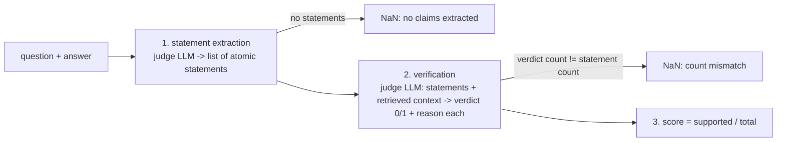
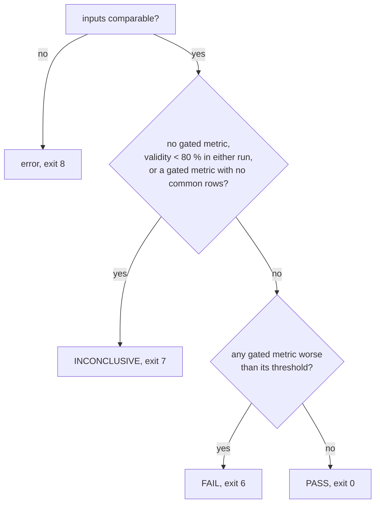

# Evaluation methodology

What RAG Regression Lab measures, how a comparison becomes a verdict, and how to read the results. Architecture: [architecture.md](architecture.md). Usage: [README](../README.md).

## Contents

1. [Dataset](#1-dataset)
2. [Metrics](#2-metrics)
3. [Faithfulness in detail](#3-faithfulness-in-detail)
4. [Per-run aggregation](#4-per-run-aggregation)
5. [Failure modes](#5-failure-modes)
6. [Comparison and verdict](#6-comparison-and-verdict)
7. [Diagnostics](#7-diagnostics)
8. [Targets](#8-targets)
9. [Results](#9-results)
10. [Reproducibility](#10-reproducibility)
11. [How to read the results](#11-how-to-read-the-results)
12. [Ragas cross-check](#12-ragas-cross-check)

## 1. Dataset

| Item | Value |
|---|---|
| Source | SQuAD v1.1, `validation` split (`rajpurkar/squad`) |
| Corpus | every distinct `context` value, deduplicated: 2,067 passages, ids `p0000000`… in first-seen order (`data/passages.json`) |
| Gold | each question links to exactly one gold passage (`gold_passage_ids`) and keeps all SQuAD answer strings |
| Splits | `dev` 15, `val` 50, `test` 200 questions, each sampled once with seed 42 (`data/splits/*.json`) |
| Categories | restricted set `simple`, `simple_with_condition`, `comparison` (hand-tagged on dev, LLM-assisted with spot checks on val/test) |
| Build | `python -m ragregress.benchmark.loader`; the data is committed, so runs do not depend on downloads |

- The splits are three independent samples of the same question set and may overlap: they are fixed views at different speeds (dev for smoke tests, val for comparisons), not a train/test split.
- `dev` runs are marked `is_dev` and cannot be compared (the comparator rejects them).
- Why SQuAD: an exact gold passage per question makes retrieval metrics unambiguous. The price is an easy retrieval task (see [§11](#11-how-to-read-the-results)).

## 2. Metrics

All four are computed per question; each declares its regression gate on its class.

| Metric | Name | Stage | Definition | Gate |
|---|---|---|---|---|
| Recall@k | `recall_at_k` | retrieval | `|gold ∩ top-k retrieved passage ids| / |gold|`; with one gold passage this is 1 if the gold is in the top k, else 0 | 0.05 |
| MRR | `mrr` | retrieval | `1 / rank` of the first gold passage within the top k, else 0 | 0.05 |
| Token F1 | `token_prf1` | generation | SQuAD token F1 against each gold answer, best one kept | 0.05 |
| Faithfulness | `faithfulness` | generation | supported claims / extracted claims, judged against the retrieved context | 0.05 |

Details:
- **k** is the config's `top_k` (5 in all shipped configs). Only the first k retrieved chunks are scored, whatever the pipeline returns.
- **Retrieved ids** are the chunks' `source_passage_id`, so several chunks of the gold passage count once.
- **Token F1 normalisation** (SQuAD style): lower-case, remove punctuation, remove the articles *a / an / the*, collapse whitespace, split on whitespace. If either side normalises to no tokens, F1 is 1 when both are empty, else 0.
- **Answers are citation-stripped** before scoring: the built-in generator writes `[source: p…]` markers, which are removed from `answer`.
- **Gate** = the largest tolerated worsening of the paired mean, in the metric's own units (0.05 = five points on a 0–1 scale). All four metrics are higher-is-better.

## 3. Faithfulness in detail

Ragas-style, implemented in the project (`ragregress/evaluation/metrics/faithfulness/`):

| Setting | Value |
|---|---|
| Judge | `qwen2.5:7b-instruct` via Ollama by default (configurable: `judge_provider`, `judge_model`) |
| Determinism | temperature 0, seed `judge_seed` (42) |
| Structured output | `instructor` JSON mode against Pydantic schemas (`StatementGeneratorOutput`, `NLIStatementOutput`) |
| Retries | up to 3 retries per LLM call on schema-invalid output (4 requests); then the metric raises |
| Context | the retrieved chunks' text, each prefixed with its passage id |
| Missing inputs | empty question, answer or context raises (the metric is unmeasured for that question) |

Outcomes for one question:

| Situation | Stored value | Effect |
|---|---|---|
| normal | 0.0–1.0 | measured |
| no claims extracted, or verdict count mismatch | NaN with a reason | dropped from means; unmeasured for validity |
| judge output invalid after retries, or missing input | metric absent, `last_error` set, tag `judge_failed` | unmeasured; lowers validity |

Faithfulness measures **groundedness, not correctness**: an answer can be fully supported by the retrieved text and still wrong (see the example in [§9](#failure-cases)).

## 4. Per-run aggregation

| Aggregate | Rule |
|---|---|
| Metric value | mean over `judged` rows that have the metric; NaN values dropped |
| Latency | p50 and p95 per stage (`retrieve`, `generate`, `judge`) and for the per-question total; nearest-rank percentile; informational, never gated |
| Run status | `healthy` if the retrieval health probe passed, else `unhealthy` (no questions run) |

The run-level means are what `ragregress run` prints. Comparisons do **not** use them; they recompute paired means over common rows ([§6](#6-comparison-and-verdict)).

## 5. Failure modes

Each question gets one tag (first match wins, in this order):

| Tag | Condition |
|---|---|
| `failed` | retrieval or generation failed after 3 attempts, or every metric crashed |
| `judge_failed` | judged, but at least one configured metric is missing (it crashed) |
| `retrieval_miss` | Recall@k = 0 |
| `low_faithfulness` | faithfulness < 0.5 |
| `low_correctness` | token F1 < 0.3 |
| `pass` | none of the above |

Tags are derived from the same metrics they describe, so grouping by failure mode is partly circular: it helps locate regressions, it does not explain them.

## 6. Comparison and verdict

### Row classes

| Class | When | Treated as |
|---|---|---|
| measured | row judged | its values (a missing metric is unmeasured for that metric only) |
| system failure | row failed with no answer (retrieve / generate exhausted retries) | 0 on every metric, **counts as measured** |
| evaluator failure | row failed but has an answer (judging crashed) | unmeasured on every metric |

A system failure is the pipeline's fault and should hurt its scores; an evaluator failure is the judge's fault and should not decide anything.

### Comparability guards

| Condition | Result |
|---|---|
| unknown run id, a dev run, missing database | error, exit 8 |
| different `eval_split` | error, exit 8 |
| different `top_k` | warning; `recall_at_k` ungated |
| different judge (provider + model) | warning; `faithfulness` ungated |
| legacy run (no `pipeline` in its stored config) | warning |
| different question sets | warning; only common rows are compared |

### Paired statistics

For each metric: the rows measured in both runs (`n_common`), the mean of each run over those rows, `delta = after − before`, and per-row counts of better / worse / tie (tie = |difference| ≤ 1e-9).

### Validity

`validity = rows with every gated metric measured / rows attempted`, per run. Below **80 %** in either run, the comparison cannot be trusted.

### Verdict

- "Worse than its threshold" means `before − after > threshold + 1e-9` (direction-aware). A worsening of exactly the threshold passes.
- An INCONCLUSIVE verdict also lists any metric that would have failed, marked as not trusted.
- The verdict is a regression gate: it says whether a change made a gated metric worse by more than tolerated, not which config is better.

## 7. Diagnostics

Read-only breakdown of one comparison (`ragregress compare --worst N`, the HTML report, the API):

| Output | Rule |
|---|---|
| Worst rows per gated metric | rows that got worse, sorted by worsening (then qa_id), top N |
| Report drill-downs | rows ranked by their largest worsening across gated metrics, then by how many metrics got worse; shows both answers, scores, retrieved passages and missing gold passages |
| Groups | by category and by the candidate's failure-mode tag: mean delta and worse / better counts per gated metric; groups with fewer than 3 rows are flagged |
| Notes | system failures in baseline / candidate are marked on the row |

Diagnostics never change the verdict or the exit code.

## 8. Targets

Written down before any real run (`configs/targets/squad_val.yaml`, from the README's DEC-03) and never adjusted afterwards:

| Metric | Target | Reasoning at the time |
|---|---|---|
| Recall@5 | 0.80–0.85 | small, topically distinct corpus; MiniLM should do well despite SQuAD's paraphrasing |
| MRR | 0.65–0.75 | trails recall: in the top 5 is not rank 1 |
| Answer F1 | 0.55–0.65 | a 3B generative model with the right context, below fine-tuned extractive models |
| Faithfulness | 0.80–0.90 | with the gold passage usually retrieved, answers should stay grounded |

The report shows each run against these ranges (below / within / above), using the same common-row means as the metric table.

## 9. Results

val split, 50 questions, top-k 5, generator `qwen2.5:3b-instruct`, judge `qwen2.5:7b-instruct`. Each candidate changes one thing from `baseline` (MiniLM-L6, chunk 500 / overlap 50). Re-checked against the database on Nov 2, 2026.

| Metric | Target | baseline | chunk_1000 | bge_small | rerank_minilm |
|---|---|---|---|---|---|
| Change | | — | chunk 1000 | `BAAI/bge-small-en-v1.5` | cross-encoder, top 20 → 5 |
| Validity | | 50/50 | 48/50 | 49/50 | 48/50 |
| Recall@5 | 0.80–0.85 | 0.8800 | 0.9200 (+0.0400; 3 b / 1 w) | 0.8800 (0.0000; 4 b / 4 w) | 0.9400 (+0.0600; 4 b / 1 w) |
| MRR | 0.65–0.75 | 0.7157 | 0.6890 (−0.0267; 9 b / 10 w) | 0.8100 (+0.0943; 13 b / 5 w) | 0.8867 (+0.1710; 15 b / 5 w) |
| Token F1 | 0.55–0.65 | 0.2132 | 0.2530 (+0.0398; 14 b / 7 w) | 0.2430 (+0.0297; 13 b / 12 w) | 0.2454 (+0.0322; 15 b / 8 w) |
| Faithfulness | 0.80–0.90 | 0.7391 | 0.7766 (+0.0375; 11 b / 7 w) | 0.7296 (−0.0148; 11 b / 10 w) | 0.7170 (−0.0259; 8 b / 8 w) |
| Verdict | | — | PASS | PASS | PASS |

b / w = questions better / worse than the baseline. Values are paired means over common rows; because the common rows differ per pair, the baseline's faithfulness is 0.7391 / 0.7444 / 0.7429 in the three comparisons (shown: standalone, n = 48).

**Target vs actual:** Recall@5 above target for all; MRR within (baseline) or above (bge_small, rerank_minilm); Token F1 far below for all; faithfulness below for all.

### Failure cases

- **Reranker pushes the gold passage out** (`5725cb33271a42140099d1df`, "What does ctenophore use to capture prey?", gold *colloblasts*): baseline has the gold at rank 3 and mentions colloblasts (Recall 1, F1 0.1176, faithfulness 1.0); rerank_minilm loses the gold from the top 5 and gives a generic answer (Recall 0, F1 0, faithfulness 1.0). Grounded, but wrong.
- **Judge output that does not fit the schema** (`572a07a86aef0514001551d5`, rerank run): the verification reply lost its `verdict` field on all 4 attempts; faithfulness unmeasured, tag `judge_failed`.
- **Judge inconsistency on refusals:** identical answers and identical refusals scored 1.0 in one run and 0.0 in another; in the rerank run 9 of 10 refusals scored 0.0.

## 10. Reproducibility

| Run | Environment | Result |
|---|---|---|
| `val-demo-rerank-20261028-133845` | Windows host, GPU, CLI | reference |
| `val-2106599c-20261102-102626` | Linux container, CPU-only torch, `POST /runs` | same `config_hash`; **identical value on every question for all four metrics** (0 better / 0 worse) |

Only latency differed: retrieve p50 77 ms (GPU) vs 466 ms (CPU); total p50 about 23 s per question in both, dominated by the judge (two LLM calls per question). With temperature 0 and fixed seeds, a stored run is a reproducible baseline across machines and over time.

## 11. How to read the results

| Caveat | Consequence |
|---|---|
| **n = 50** | little statistical power; a 0.04 recall change is 2 questions. Read deltas as directional; the gate is for catching regressions, not for ranking configs. |
| **Judge consistency** | the 7B judge scores the same answer differently across contexts; refusals are often scored 0. Small faithfulness deltas (such as rerank's −0.0259, 8 better / 8 worse) are within judge noise. |
| **Token F1 vs a sentence-style generator** | SQuAD gold answers are short spans; a generator that answers in sentences scores low even when correct (likely cause of F1 far below target; not measured separately). |
| **Easy retrieval** | one gold passage, a small, topically distinct corpus: recall saturates quickly; no hybrid retrieval was tested. |
| **Failure-mode groups** | tags come from the same metrics, so groups describe rather than explain. |
| **Category groups** | val has three categories of very different sizes; small groups are flagged and anecdotal. |
| **Faithfulness ≠ correctness** | read it together with token F1 (see the ctenophore case). |

## 12. Ragas cross-check

`scripts/ragas_faithfulness_check.py` scores a handful of questions with both this project's faithfulness metric and Ragas's, using the same local judge model, as a sanity check of the implementation (Ragas is not used anywhere else). The comparison is stored in `results/ragas_faithfulness_check.json`. It needs `pip install ragas==0.4.3 langchain-community==0.3.31` and expects Ollama at `localhost:11434`.